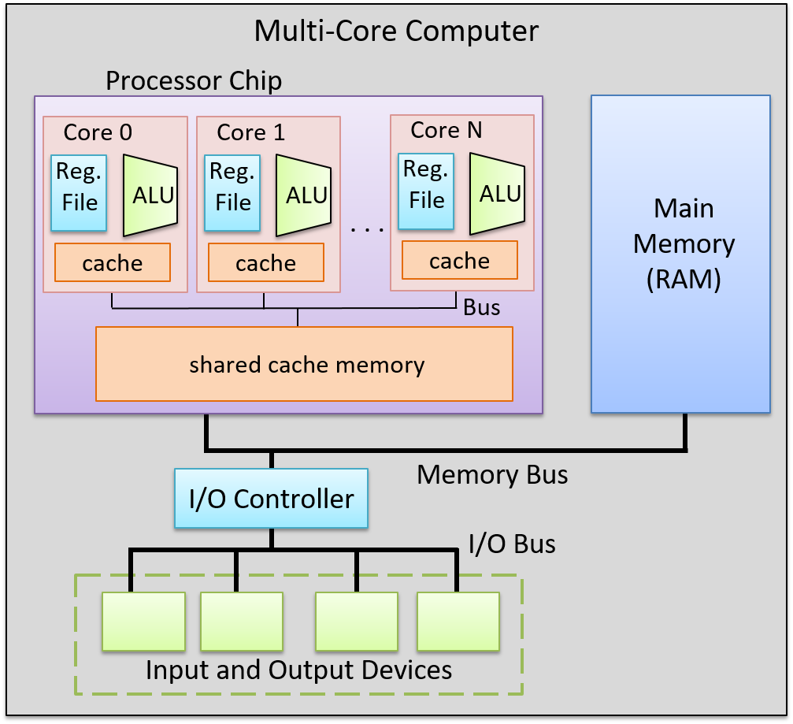

# Multiprocessor Systems

For decades, chips got faster in two ways: higher clock speeds, and **instruction-level parallelism**, the tricks a single processor uses to run several instructions at once. That kept performance growing in line with Moore's Law through the early 2000s, but then it hit a wall. Pushing the clock any higher would have made chips use far too much power. So architects started putting several processors (cores) on one chip, and today almost every computer is multicore. These extra cores speed up a program only when programmers write code that runs in parallel.

> [!DEFINITION]
> A **multiprocessor system** is basically a team of processors working toward the same goal: finishing the work faster. We usually sort these systems by two questions. First, how do the processors get to memory? Second, is every processor the same kind, or does the system combine different kinds of processors?

## Introduction

### Shared Memory Multiprocessor Systems

> [!DEFINITION]
> In a **shared memory multiprocessor system**, every processor can read and write the same physical memory. You can think of it like roommates sharing one whiteboard on the fridge. If one of them wants to tell the others something, they just write it on the board. Processors work the same way: they communicate through shared variables instead of sending each other messages.

Each processor also keeps its own private cache, which is a small, fast copy of the parts of memory it's working with. That means two processors could end up holding different copies of the same data. So these systems need **cache coherency** mechanisms to make sure every processor sees the same, correct values. We'll look at how that works in the Cache Coherence section below.

Shared memory systems come in two kinds, **UMA** and **NUMA**, depending on whether every processor can reach memory equally fast.

#### Uniform Memory-Access (UMA) System

> [!DEFINITION] Uniform memory access
> In a **UMA (Uniform Memory Access)** system, every processor takes the same amount of time to reach any part of memory.

UMA systems are usually built using **Symmetric Multiprocessing (SMP)**. In SMP, several identical processors run under a single operating system. They all share the main memory, the I/O devices, and the interrupt system through one common connection called the system bus. Even though they share all of that, each processor can still run a different program on different data. Each one also has its own local cache, which sits between the processor and main memory as a fast middleman.

#### Non-Uniform Memory-Access (NUMA) System

SMP works well for a handful of processors, but it doesn't scale forever. To keep their caches consistent, SMP processors use **bus snooping**, which means every processor listens to all the traffic on the shared bus. That works up to around 8 to 16 processors. Beyond that, things start to break down. All the snooping and invalidation messages flood the bus with traffic. At high clock speeds, even the length of the wires becomes a problem, because signals take real time to travel. And a single memory controller simply can't supply enough bandwidth for that many processors at once.

> [!DEFINITION] Non-uniform memory access
> **NUMA (Non-Uniform Memory Access)** fixes this by splitting memory up into nodes. Each node has one or more processors and its own local memory. Every processor can still reach every memory address, so the system still has one shared address space. The difference is that access time now depends on where the data lives. Reading from your own node's memory is fast. Reading from another node's memory is much slower, because the request has to travel across the interconnect between nodes. It's a bit like a company with offices in several cities: grabbing a file from your own office is quick, but asking another office to send one over takes a while. Because there's no longer one shared bus for everyone to fight over, NUMA systems can scale to hundreds or even thousands of processors.

Since there's no shared bus to snoop on, NUMA systems keep their caches consistent a different way, using **directory-based protocols**. Each node has directory hardware, usually built into or near its memory controller, that keeps track of the memory living on that node. For every cache line, the directory records two things: a valid bit for each processor, which says whether that processor has the line cached, and a dirty bit, which says whether any processor has modified it.

When a processor wants some data, its request goes to that data's home directory, meaning the directory on the node where the memory lives. If the data is clean, the directory sends it right over and sets the valid bit for the requesting processor. If the data is dirty, the directory first gets the latest version from the processor that changed it, writes it back to main memory, and then hands it to the requester. When a processor writes to a cache line, the directory sends invalidate messages only to the processors whose valid bits are set, the ones that actually have a copy.

In SMP, invalidate messages are broadcast to every processor on the bus, and each one has to check whether the message applies to it. Sending invalidations only to the processors that hold a copy cuts out a huge amount of this traffic. For very large systems, directories can even be stacked into a hierarchy, with several levels talking over general-purpose networks instead of CPU buses.

### Distributed Memory Multiprocessor Systems

In a **distributed memory multiprocessor system**, each node has its own private memory, and there's no shared address space at all. One processor can't read or write another processor's memory directly. If nodes need to share data, they have to send explicit messages over a network. Going back to the roommates, this is like everyone living in separate apartments and texting each other instead of sharing a whiteboard.

This design scales to thousands or even millions of nodes, which is why clusters and supercomputers use it. It works especially well for embarrassingly parallel workloads, meaning jobs that split into pieces that do lots of computing and barely need to talk to each other. The downside is that sending data over a network is orders of magnitude slower than reading it from RAM. That makes this design a poor fit for algorithms where nodes constantly need to swap data.

### Homogeneous and Heterogeneous Multiprocessor Systems

So far we've sorted systems by how their processors get to memory. The second question is whether all the processors are the same kind.

In a **homogeneous multiprocessor system**, every core is the same design. Classic desktop and server chips work this way, and the SMP systems described above are the usual example. Because every core is identical, any task can run on any core equally well. That makes these systems simple to program and simple for the operating system to schedule.

In a **heterogeneous multiprocessor system**, the chip combines different kinds of processors, and each one is good at a different job. One common version mixes big and small cores from the same family. Apple's M-series chips have performance cores and efficiency cores, Intel chips since Alder Lake have P-cores and E-cores, and ARM calls this design **big.LITTLE**. Heavy work, like compiling code or playing a game, goes to the big cores, which are fast but power-hungry. Background work, like checking email, goes to the small cores, which are slower but use much less power. This split lets a modern laptop or phone run demanding work quickly while keeping its battery life long.

Another version goes further and combines completely different types of processors. A phone chip, for example, might put CPU cores next to a GPU for graphics, an NPU for AI, and a DSP for audio and camera signals, all on the same piece of silicon. Each of these handles its kind of work far more efficiently than a general-purpose CPU could.

Heterogeneous systems are harder to use well, because the operating system and programmers have to decide which work goes to which processor, and a bad choice wastes either speed or power.

## Cache Coherence

> [!DEFINITION] Cache coherency
> Since each processor keeps its own private cache, the critical challenge in SMP systems is maintaining **cache coherency**: ensuring all processors see a consistent view of memory. When one processor modifies data, other processors may hold stale copies, creating inconsistency. SMP systems solve this through **bus snooping**, where each processor monitors a shared bus for cache events from other processors and updates its cache accordingly.

Cache coherency is managed through hardware protocols, with **MESI** being the most common (other protocols include **MOESI** and **MESIF**). 

MESI stands for the four states a cache line can be in: 
- **Modified**
- **Exclusive**
- **Shared**
- **Invalid**

The protocol assigns one of four states to every cache line (mostly in L1 cache), answering two questions at all times: _is main memory up to date?_ and _does any other cache hold a copy?_

- **Modified (M)**: This cache has the only copy, and it has been written to. Main memory is stale. This cache is solely responsible for writing the data back before anyone else can use it.
- **Exclusive (E)**: This cache has the only copy, which matches main memory. Since no other cache holds the line, a write can proceed without any bus communication.
- **Shared (S)**: This cache holds a copy, and other caches may too. All copies match main memory. The line is effectively read-only, since a write requires coordinating with other caches first.
- **Invalid (I)**: The cache line holds no usable data. Any access is a miss.

For any two caches, the permitted combinations of states for the same cache line are:

| | M | E | S | I |
| :---: | :---: | :---: | :---: | :---: |
| **M** | No | No | No | Yes |
| **E** | No | No | No | Yes |
| **S** | No | No | Yes | Yes |
| **I** | Yes | Yes | Yes | Yes |

Since Modified and Exclusive both mean "I am the only cache holding this line," they exclude every other state except Invalid. Shared can coexist only with Shared or Invalid, since it just means multiple caches hold a clean, read-only copy, which is safe.

### MESI State Transitions

In the scenarios below, Core A is the cache whose state is transitioning. Core B is any other core on the bus whose request Core A observes via snooping.

#### Read miss, no other holder (Invalid → Exclusive)

Core A misses on a read and broadcasts a request on the bus. No other cache responds. Core A fetches the block from main memory and marks it Exclusive, as it is the sole holder and main memory is authoritative.

#### Read miss, another cache holds it (Invalid → Shared)

Core A misses and broadcasts a read request. Core B holds the line and transitions as a consequence:
- If B is in Shared, B stays Shared and Core A loads the line as Shared.
- If B is in Exclusive, B transitions to Shared and Core A loads the line as Shared.
- If B is in Modified, B intercepts the request, writes the dirty data back to main memory first, then both B and Core A transition to Shared.

Once two caches hold the same cache line, both are Shared.

#### Write miss (Invalid → Modified)

Core A has the line as Invalid and wants to write. Core A broadcasts a read-with-intent-to-modify request and fetches the block. Any other cache holding the line must give up its copy as a consequence: if Modified, it writes the dirty data back to main memory first, then goes Invalid; if Exclusive or Shared, it goes Invalid immediately. Core A transitions to Modified and writes.

#### Read hit (Exclusive → Exclusive)

Core A holds the line as Exclusive and reads from it. The data is served directly from the local cache. No bus traffic.

#### Write hit (Exclusive → Modified)

Core A holds the line as Exclusive and wants to write. Since no other cache has a copy, Core A simply writes and transitions to Modified with no bus traffic. This is the fast path.

#### Read hit (Shared → Shared)

Core A holds the line as Shared and reads from it. The data is served directly from the local cache. No bus traffic.

#### Write hit (Shared → Modified)

Core A holds the line as Shared and wants to write. Since Core A already has a valid copy, it broadcasts an invalidate request on the bus. Every other cache holding the line transitions to Invalid as a consequence. Core A transitions to Modified and performs the write. Main memory is now stale.

#### Read or write hit (Modified → Modified)

Core A holds the line as Modified and reads or writes to it again. It is already the sole owner with the authoritative copy, so it serves the access locally and stays Modified. No bus traffic.

#### Eviction (Modified → Invalid)

Core A needs to load a new block into a slot occupied by a Modified line. Before evicting, Core A writes the dirty data back to main memory, then transitions to Invalid and frees the slot.

## Memory Consistency

Cache coherency protocols (MESI or MOESI) guarantee that all cores will _eventually_ see the correct value for a memory location, but they say nothing about _when_ that value becomes visible. This is the problem of **memory consistency**: the rules for the order in which memory operations performed by one core become visible to others.

> [!NOTE]
> People often conflate coherence and consistency, but they answer different questions. Cache coherence governs reads and writes to the _same_ memory address, aiming to make a parallel memory system behave as if the caches were not there, just like a uniprocessor's cache stays invisible to the programmer. Memory consistency, by contrast, governs reads and writes to _different_ addresses: specifically, when a write to X becomes visible relative to reads and writes to other addresses.

### The Hardware Gaps

Two hardware structures create windows where cores see inconsistent state even with cache coherency protocols in place.

#### Write buffer (store buffer)

When a core writes a value, the write first lands in a **write buffer**, a small queue between the core and its L1, so the core can keep executing without stalling on every write. While a write sits in the buffer, MESI has not triggered yet (i.e., no invalidate has been sent), so other cores reading that address load the old value from their own caches, unaware anything changed.

> [!NOTE]
> Write buffering preserves single-threaded behavior through **store-to-load forwarding**: before going to memory, a read first checks the store buffer for a pending write to the same address, and uses that value if found. In `x = 1; println(x)`, for instance, the write `x = 1` sits in the store buffer before reaching main memory, but `println(x)` forwards directly from the buffer and correctly prints `1`.

To see how this breaks down with multiple threads, consider two threads running concurrently, where `x` and `y` both start at `0` in memory:

- Thread 1: (1) `x = 1`, then (2) `print(y)`
- Thread 2: (3) `y = 1`, then (4) `print(x)`

First, (1) and (3) execute, placing `x = 1` and `y = 1` into their respective store buffers before either write reaches main memory. Then (2) executes on Core 1, reading `y`: its store buffer has no entry for `y`, so it reads from memory and gets `0`. Next, (4) executes on Core 2, reading `x`: its store buffer has no entry for `x` either, so it too reads from memory and gets `0`. At some indeterminate point later, the cache hierarchy drains both store buffers and propagates the writes to memory.

Under x86-TSO and relaxed memory models, this program can therefore print `00`, since both threads observe the other's write as if it hadn't happened yet. SC explicitly rules out this outcome, since it requires a completed write to be immediately visible to all cores. Store buffers introduce exactly this kind of surprise: writes "done" from the issuing core's perspective stay invisible to everyone else until the buffer drains.

#### Invalidation queue

When a write finally commits from the write buffer to L1, MESI sends an invalidate message to every other cache holding that line. The receiving core can delay acknowledging it by placing it in an **invalidation queue**, so the core does not stall waiting. If a read happens before those invalidations process, the core hits its own now-stale cache line and returns the old value, even though an invalidation was already pending.

So there are two windows where a core can observe stale data:
1. While the write is still in the writer's store buffer (before reaching L1, before any invalidate is sent)
2. While the invalidation is sitting in the reader's invalidation queue (sent, but not yet acknowledged)

### Hardware Memory Models

> [!DEFINITION]
> A **memory consistency model** defines what guarantees a CPU architecture makes about when writes become visible to other cores. Different architectures make different tradeoffs between performance and strictness.

There are four possible ordering constraints between memory operations, where X and Y are not necessarily the same address:
- **W→R**: a write to X must commit before a subsequent read from Y
- **W→W**: a write to X must commit before a subsequent write to Y
- **R→R**: a read from X must commit before a subsequent read from Y
- **R→W**: a read from X must commit before a subsequent write to Y

A memory model is defined by which of these it enforces. Relaxing a constraint means the hardware is free to reorder those operations for performance.

#### Sequential Consistency (SC)

Defined by Lamport (1976), **sequential consistency** is the ideal model that enforces all four orderings. It makes two guarantees: every memory operation across every core appears to execute in one global sequential order, and each core's own operations appear in that order exactly as they appear in the program (program order). The system therefore behaves as if all cores share a single memory with no caches or buffers, like a switch that picks one core at a time, completes its memory operation atomically, then picks another.

In practice, no modern high-performance CPU implements sequential consistency fully, since doing so would require flushing the store buffer and draining the invalidation queue on every operation, eliminating the very optimizations that make out-of-order and pipelined execution fast.

> [!NOTE]
> The switch can pick any core at any time, so instructions from different cores freely interleave in the global order. It cannot, however, violate a single core's program order: P0's stores and loads must appear in the global sequence in the same order they appear in P0's program, and likewise for every other core.

#### x86 Total Store Order (x86-TSO)

Total Store Order enforces W→W, R→R, and R→W, but **relaxes** W→R: a write sitting in the store buffer can be bypassed by a subsequent read to a different address, so the core reads from its cache before the write commits. Once a write does reach L1, invalidations broadcast to all other cores and process promptly, so although a write may be delayed in the store buffer, all cores observe it at the same time once it lands. Every core therefore agrees on a single coherent global order of writes. TSO is strict enough that most concurrent code works correctly on x86 without explicit memory fences.

#### ARM Relaxed Memory Model

ARM's relaxed memory model can relax all four orderings, making it the weakest common model. Cores can observe writes from other cores in a different order than they occurred, and even two cores can disagree on the order in which writes became visible. Correct concurrent code on ARM therefore requires explicit memory fences at every synchronization point.

### Memory Fences

> [!DEFINITION]
> A **memory fence** (a.k.a memory barrier) is an instruction that forces the CPU to flush one or both buffers before continuing:
> - **Store fence**: drain the write buffer so all pending writes reach L1 (and invalidates are sent) before any subsequent stores.
> - **Load fence**: drain the invalidation queue so all pending invalidations are acknowledged before any subsequent loads.
> - **Full fence**: both.

However, memory fences are notoriously expensive, costing hundreds of CPU cycles, and are tricky to use correctly.

This is why concurrent programming requires atomics, mutexes, and memory ordering annotations even on hardware with full MESI coherency: MESI guarantees the right value will eventually be visible, but without explicit fences, there is no guarantee about _when_.

## Atomicity

> [!DEFINITION]
> An **atomic operation** is an operation that other cores can only observe as either not yet started or fully finished.

To see why we need them, consider incrementing a shared counter with `counter += 1`. The CPU carries it out in three steps: 
1. it **loads** the value from memory into a register
2. **adds** one to the register
3. **stores** the result back to memory. 

Even when the compiler emits the single x86 instruction `add [mem], 1`, the core still splits it into these three steps internally.

Cache coherence protects each of these steps individually. MESI prevents two problems:
- **Simultaneous writes**: only one core can hold a line in Modified at a time, so two stores to the same line are always applied one after the other.
- **Stale cache reads**: when a core writes, every other cached copy is invalidated, so the next load on any core fetches the new value.

However, MESI makes no promises about the time between the load and the store. MESI tracks the copies of data held in caches, and a value that a core has loaded into a register sits outside its protection. During those few cycles, another core is free to take the cache line and change it, and nothing updates the stale value in the register.

Suppose `counter` starts at `5` and two cores increment it at the same time:

| Step | Core 0 | Core 1 | Line state (C0 / C1) |
| :---: | :---: | :---: | :---: |
| 1 | load → 5 | | E / I |
| 2 | | load → 5 | S / S |
| 3 | add → 6 | add → 6 | S / S |
| 4 | store 6, invalidate C1 | | M / I |
| 5 | | store 6, invalidate C0 | I / M |

Every step in this sequence follows MESI, and the counter still ends at `6` after two increments. Core 1 correctly read `5` in step 2, but it kept that value in a register while Core 0 updated the counter, so its store in step 5 overwrote Core 0's result with a value computed from stale data. This is called a **lost update**, and it is one form of the data race described in [Synchronization](../operating-systems/synchronization.md).

An **atomic instruction** prevents lost updates by holding the cache line for the entire read-modify-write. On x86, an instruction becomes atomic when it carries the `lock` prefix, as in `lock add [mem], 1`, and Rust's `counter.fetch_add(1, Ordering::Relaxed)` compiles to this kind of instruction. The core begins by requesting the line in Modified, which invalidates every other copy before the load even happens. It then performs the load, the add, and the store while keeping the line locked in its own cache. If another core requests the line during this time, the owning core delays its response until the store completes, and only then hands over the line, which now holds the updated value. Under plain MESI, a core must give up a line as soon as another core asks for it, so an atomic instruction is MESI's normal ownership plus a short "don't give it up yet" window.

| Step | Core 0 | Core 1 | Line state (C0 / C1) |
| :---: | :---: | :---: | :---: |
| 1 | request line in M, lock it | | M / I |
| 2 | load 5, add, store 6 | request line, wait | M / I |
| 3 | unlock, hand line over | receive line holding 6 | I / M |
| 4 | | load 6, add, store 7 | I / M |

Since the lock is confined to a single cache line in a single core's cache, other cores can keep accessing the rest of memory while the atomic instruction runs. The core simply keeps one line in Modified for a few extra cycles and postpones its reply to coherence requests, relying on MESI's existing rule that only one core may hold a line in Modified at a time. Older processors achieved atomicity by locking the entire memory bus, and modern x86 processors still fall back to a bus lock when an atomic instruction touches data that straddles two cache lines.

The cost of an atomic instruction depends on how many cores are using the same line. When only one core updates the counter, the line is already in its cache in Modified, and the atomic instruction costs on the order of tens of cycles, slightly more on x86 because a locked instruction also acts as a full memory fence. When many cores update the same counter, each one needs the line in Modified in turn, so the line moves from core to core on every increment, producing the write contention described in [Atomics](../performance-engineering/atomics.md#performance-problems).

Putting it all together, correct concurrent code rests on three separate guarantees, each answering a different question:

| Guarantee | Question it answers | Enforced by |
| :---: | :---: | :---: |
| Cache coherence | Do all cores agree on the value at a single address? | The coherence protocol (e.g., MESI), automatically in hardware |
| Memory consistency | In what order do operations on different addresses become visible to other cores? | The hardware memory model (x86-TSO, ARM), plus fences |
| Atomicity | Can a read-modify-write complete without another core getting in between? | Atomic instructions (e.g., the `lock` prefix on x86) |
