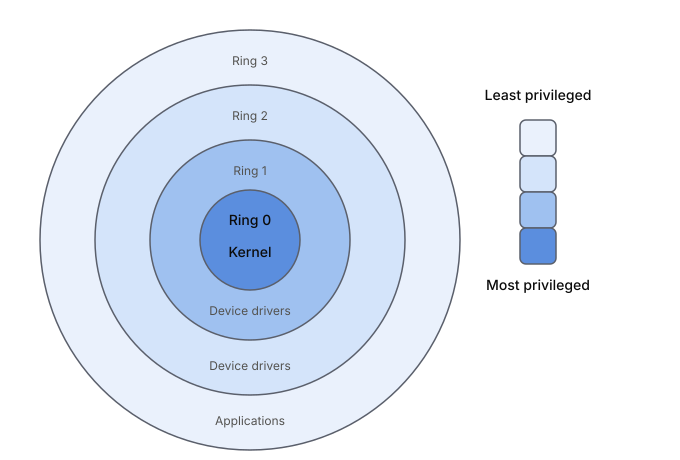

# Introduction to Operating Systems

## Definition

> [!definition]
> An **operating system** is system software that manages a computer's hardware resources (CPU, memory, storage, and I/O devices) by allocating them efficiently and safely among competing programs, while presenting users and applications with a simplified, consistent interface that hides the hardware's complexity.

For instance, it creates it provides the following abstractions: 

| Hardware | Abstraction |
| :---: | :---: |
| Processor | Thread |
| Memory | Address Space |
| Storage | Files |
| Networks | Sockets |
| Machines | Processes |

## POSIX, UNIX, Unix-like

Operating systems differ in how they implement the same basic functionality. A program that depends on one system's file handling, process creation, or shell behavior may break on another. **POSIX** is a set of IEEE standards that defines a common interface for system calls, the shell, and core utilities, so software written to it can be ported across systems with little or no change. But, conforming to POSIX is entirely optional. Linux and most BSDs follow it closely, but haven't paid for formal certification, which is expensive and gives most vendors little in return. **UNIX** is a trademark owned by The Open Group, granted to systems that pass the Single UNIX Specification test suite, which covers all of POSIX, plus additional interfaces. macOS holds this certification, while Linux is usually called **Unix-like**.

## Kernel

> [!definition]
> The operating system's core program that always runs is called the **kernel**.

The kernel communicates to the hardware directly, or through systems programs called **device drivers**.

## Privileges

The hardware is organized in terms of protection rings. It has at least two protection rings:
- Ring 0: Kernel/supervisor/priviledged mode
  - full access to all hardware
  - the kernel is the systems program that runs here
- Ring 3: User mode
  - restricts access on which instructions can be executed and which memory can be accessed.
  - regular applications programs run here

This is enforced by a special register or a flag in the CPU, called a **mode bit**, that tracks which mode it's currently in. 
- `mode bit = 1`: kernel mode.
- `mode bit = 0`: user mode.

## System Call

In order for applications programs to perform privilege operations, it must request the kernel to carry it out on its behalf, and waits for the result. We call this request a **system call**. 

System calls vary in terms of the specific operation being requested (e.g., reading a file, writing to a socket, allocating memory, creating a process, etc.) and the kernel keeps track of and distinguishes between them by assigning each one a unique integer ID called a syscall number.

A system call work as follows:

1. The application program calls a specific system call via a small wrapper function (usually in libc). This wrapper function will:
   - Move the syscall number and the syscall arguments each into registers
   - Execute the `syscall` instruction, triggering a **trap**: a synchronous exception, reproducible at exactly the same point in the code on re-run.
3. The trap instruction will them perform two actions atomically:
    - Switch the CPU's privilege level from ring 3 to ring 0 by flipping the mode bit from 1 to 0
    - Jump to a fixed, kernel-controlled entry point
4. The kernel looks at a syscall number and arguments, and performs the operation itself.
5. The kernel executes a return-from-trap instruction which switches the CPU back to ring 3 and resumes the application program.

