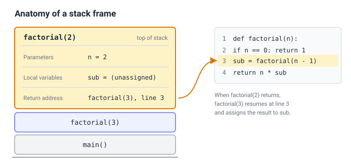
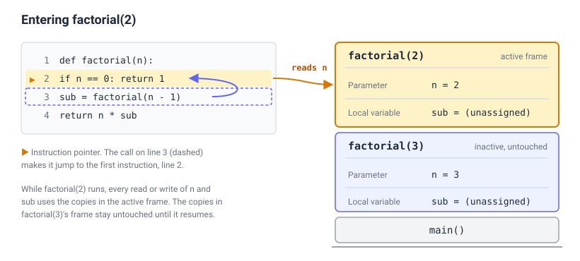
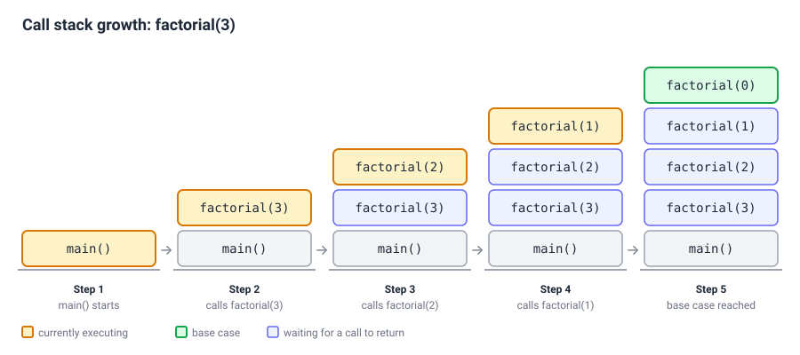
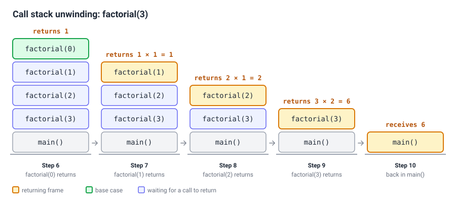
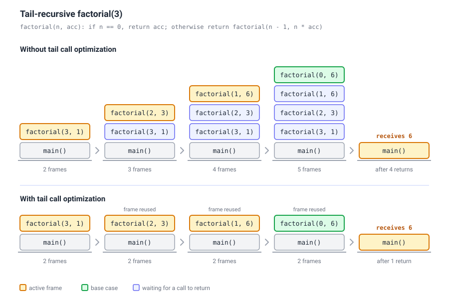

# Recursion

## Introduction

> [!DEFINITION]
> **Recursion** is a mechanism in which a problem is solved by defining a solution in terms of smaller instances of the same problem.

We can implement a recursive algorithm by modelling it as a **recurrence relation**:
- **Base Case(s)**: A simple occurrence that can be answered directly.
- **Recursive Case(s)**: A more complex occurrence of the problem that cannot be directly answered but can instead be described in terms of smaller occurrences of the same problem.

A recursive algorithm is implemented as a function that calls itself. Each call works on a simpler subproblem than the one before, and to guarantee termination, every recursive call must make progress toward a base case: a subproblem simple enough to solve directly, without recursing further. Some recursive algorithms have more than one base case or recursive case, but every recursive algorithm must have at least one of each.

What makes this work is the call stack, a region of memory that keeps track of the active function calls in a running thread. Each time a function is called, including when it calls itself, the program creates a new stack frame and pushes it onto the top of the call stack. The frame stores the function's parameters, local variables, and return address (the point in the calling code where execution resumes once the call completes). 



The instruction pointer then jumps to the first instruction of the called function, and the new stack frame becomes the active one. This means that whenever the function reads or writes its parameters and local variables, it will use the copies stored in the active frame. Because every recursive call gets its own stack frame, each call has its own copies of these variables, so the calls don't interfere with one another. 



Stack frames keep piling up until a call's input satisfies the base case. 



That call returns without recursing further, and the stack begins to unwind. Each return pops a stack frame off the top of the stack, and control passes back to the caller, along with any return value, while the caller's frame becomes active again. Unwinding continues until control returns to the original call.



## Template

To create recursive algorithms, ask the following questions:
1. What does `f()` mean? What does the current subproblem need to know that it can't figure out itself? These become the function's parameters. What useful information can this subproblem give back to its caller? These become the return values of the function. Do I need to maintain a global `result` variable across multiple recursive calls?
2. What is/are the base case(s)? For trees, it's often when the `root`/`node` is `None`, for arrays and strings, it's either when `i` is at `0` or at `array.count()`.
3.. What smaller version of the exact same problem can I ask recursion to solve? For trees, it's often recursing on the children nodes, for graphs, it's recursing on the neighbour vertices, for arrays, it's recursing the previous or next element, or for an integer $n$, it's recursing on a smaller $n$.
4. How do I use the recursive result(s) to produce the current result?

## From Recursion to Iteration

...

## Tail Recursion 

> [!DEFINITION] Tail recursion
> In a traditional recursive function, calculations happen after the recursive call returns. In a **tail-recursive function**, the recursive call is the absolute _last_ operation executed by the function.

The tail-recursive function lends itself to better memory usage, as in certain languages that support **Tail Call Optimization**, the compiler automatically optimizes tail-recursive functions into loops under the hood. Specifically, instead of adding a new stack frame for every call, it continuously reuses the same stack frame, preventing stack overflow errors. As a consequence, when the function recurses to the base case, the function can simply return the result to the original caller without going back to the previous function calls.



To turn a standard recursive function into a tail-recursive function, there are two common approaches:
- **Accumulator**: Pass partial results forward using an accumulator argument, so there is no remaining work to perform after the recursive call returns.
- **Continuation (CPS)**: Pass the remaining work forward using a continuation, often named k. The continuation is a function that represents the work still to be performed and effectively models the pending computations of the call stack.

### Accumulator

1. Add an accumulator argument, usually named `acc`, to the recursive helper function.
2. Initialize the accumulator with the result corresponding to the base case.
3. Base case: Return the accumulator instead of returning the original base-case result.
4. Recursive case: Update the accumulator with the work that would have been performed after the recursive call.
5. Make the recursive call the final operation. 

#### Example 

```ocaml
let rec sum l =
  match l with
  | [] -> 0
  | h :: t -> h + sum t
```

turned into

```ocaml
let sum_tr l =
  let rec helper l acc =
    match l with
    | [] -> acc
    | h :: t -> helper t (acc + h)
  in
  helper l 0
```

### CPS 

1. Add a continuation higher-order function, usually named `k`, as an additional argument. 
2. Base case: Apply `k` to the base case's result.
3. Recursive case: Move all the work that previously happened after the recursive call into the continuation.
4. Make the recursive call the final operation.

#### Example 1

```ocaml
let rec append l1 l2 =
  match l1 with
  | [] -> l2
  | h :: t -> h :: append t l2
```

turned into 

```ocaml
let rec append_tr l1 l2 =
  let rec helper l1 l2 k =
    match l1 with
    | [] -> k l2
    | h :: t -> helper t l2 (fun r -> k (h :: r))
  in
  helper l1 l2 (fun r -> r)
```

where for example, `append_tr [1; 2] [3; 4]` executes as follows:

```
append_tr [1; 2] [3; 4]
=> helper [1; 2] [3; 4] (fun r -> r)
=> helper [2] [3; 4] (fun r1 -> (fun r -> r) (1 :: r1))
=> helper [] [3; 4] (fun r2 -> (fun r1 -> (fun r -> r) (1 :: r1)) (2 :: r2))
=> (fun r2 -> (fun r1 -> (fun r -> r) (1 :: r1)) (2 :: r2)) [3; 4]
=> (fun r1 -> (fun r -> r) (1 :: r1)) (2 :: [3; 4]))
=> (fun r -> r) (1 :: 2 :: [3; 4]) 
=> (1 :: 2 :: [3; 4])
=> [1; 2; 3; 4]
```

#### Example 2

For a binary tree

```ocaml
type 'a tree =
  | Empty
  | Node of 'a tree * 'a * 'a tree
```

We have the traditional `find_all` recursive function

```ocaml
let rec find_all predicate tree =
  match tree with
  | Empty -> []
  | Node (left, value, right) ->
      if predicate value then
        (find_all predicate left) @ (value :: (find_all predicate right))
      else
        (find_all predicate left) @ (find_all predicate right)
```

turned into the tail-recursive function via CPS

```ocaml
let rec find_all_tr predicate tree =
  let rec helper predicate tree k =
    match tree with
    | Empty -> k []
    | Node (left, value, right) ->
        helper predicate left
          (fun left_results ->
            helper predicate right
              (fun right_results ->
                if predicate value then
                  k (left_results @ (value :: right_results))
                else
                  k (left_results @ right_results)))
  in
  helper predicate tree (fun results -> results)
```

## When to Avoid Recursion

- Some programming languages impose a limit on the size of the call stack, and do not support tail-call optimization, which may lead to stack overflow.
- Some languages have higher function call overhead. 


