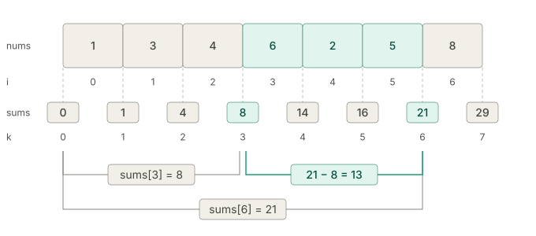

# Prefix State

## Stored in Arrays (Prefix Sum)

### Use Case

Query the sum of a range of a subarray or submatrix in $O(1)$ time.

### Template

```python
class PrefixSum1D:
    def __init__(self, nums: list[int]):
        self.sums = [0] * (len(nums) + 1)
        for i, num in enumerate(nums):
            self.sums[i + 1] = self.sums[i] + num

    def sum(self, i: int, j: int) -> int:
        """Sum of subarray from [i, j]."""
        return self.sums[j + 1] - self.sums[i]
```



> [!NOTE]
> In this 1D prefix sum with a leading 0 in the array, `self.sums[k]` means the the sum of the _first_ $k$ elements.

> [!TIP]
> The leading value is the identity of the operation, the value $e$ where combining $e$ with $x$ gives back $x$. For other prefix operations, use:
>
> | Operation | Identity | Why |
> | :---: | :---: | :---: |
> | sum | $0$ | $0 + x = x$ |
> | product | $1$ | $1 \cdot x = x$ |
> | max | $-\infty$ | $\max(-\infty, x) = x$ |
> | min | $+\infty$ | $\min(+\infty, x) = x$ |
> | OR / any | $\text{False}$ / $0$ | $\text{False} \lor x = x$, $0 \mathbin{\vert} x = x$ |
> | AND / all | $\text{True}$ / $-1$ (all bits set) | $\text{True} \land x = x$, $1\dots1_2 \mathbin{\&} x = x$ |
> | XOR | $0$ | $0 \oplus x = x$ |
> | gcd | $0$ | $\gcd(0, x) = \lvert x \rvert$ |
> | string concat | $\varepsilon$ (`""`) | $\varepsilon \cdot s = s$ |
> | list concat | $[\,]$ | $[\,] \mathbin{+\!\!+} L = L$ |
> | set union | $\varnothing$ | $\varnothing \cup S = S$ |

```python
class PrefixSum2D:
    def __init__(self, nums: list[list[int]]):
        rows = len(nums)
        cols = len(nums[0])
        self.sums = [[0] * (cols + 1) for _ in range(rows + 1)]
        for i in range(rows):
            for j in range(cols):
                self.sums[i + 1][j + 1] = (
                    self.sums[i][j + 1]
                    + self.sums[i + 1][j]
                    - self.sums[i][j]
                    + nums[i][j]
                )

    def sum(self, r1: int, c1: int, r2: int, c2: int) -> int:
        """Sum of the rectangle from [r1, r2] x [c1, c2]."""
        return (
            self.sums[r2 + 1][c2 + 1]
            - self.sums[r1][c2 + 1]
            - self.sums[r2 + 1][c1]
            + self.sums[r1][c1]
        )
```
  
## Stored in HashMaps

### Use Case

Count or find longest/shortest subarrays, submatrices, or tree paths that satisfies some condition, where that condition can be reduced to comparing a combining function of two prefix states for some invertible combine operation.

### Template

```python
def longest_subarray_with_state(array, target_state):
    """
    Returns the length of the longest subarray in `array` whose state equals `target_state`.
    """
    state_first_index = {0: -1}  # state -> FIRST index it appeared at (greedy: keep earliest)
    current_state = 0
    result = 0

    for i, num in enumerate(array):
        current_state = current_state + num  # or `current_state ^ num`, etc.

        needed_state = current_state - target_state  # or `current_state ^ target_state`
        if needed_state in state_first_index:
            result = max(result, i - state_first_index[needed_state])

        # Only store the FIRST time we see a state — a later index would only
        # ever produce a shorter subarray, so overwriting is never beneficial.
        if current_state not in state_first_index:
            state_first_index[current_state] = i

    return result
```

```python
def shortest_subarray_with_state(array, target_state):
    """
    Returns the length of the shortest subarray in `array` whose state equals `target_state`.
    """
    state_last_index = {0: -1}  # state -> MOST RECENT index it appeared at
    current_state = 0
    result = float("inf")

    for i, num in enumerate(array):
        current_state = current_state + num

        needed_state = current_state - target_state
        if needed_state in state_last_index:
            result = min(result, i - state_last_index[needed_state])

        # Always overwrite — the most recent occurrence gives the shortest
        # possible subarray for any future match.
        state_last_index[current_state] = i

    return result if result != float("inf") else 0
```

```python
def count_subarrays_with_state(array, target_state):
    """
    Returns the number of subarrays in `array` whose state equals `target_state`.
    """
    state_freq = {0: 1}  # state -> how many prefixes have had this state
    current_state = 0
    result = 0

    for num in array:
        current_state = current_state + num

        needed_state = current_state - target_state
        result += state_freq.get(needed_state, 0)

        # Every prefix state seen contributes independently, so accumulate
        # frequency rather than overwrite.
        state_freq[current_state] = state_freq.get(current_state, 0) + 1

    return result
```
