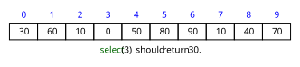

# Selection

## Problem

Given an unsorted array and an integer $k$, find the $k^\text{th}$ smallest element (i.e., the element that would be at index $k$ if the array were sorted).



## QuickSelect (Hoare's Selection Algorithm)

### Template

```python
import random


def quickselect(array, k):
    low = 0
    high = len(array) - 1

    while low <= high:
        pivot_index_random = random.randint(low, high)
        pivot_index_final = lomuto_partition(
            array, low, high, pivot_index_random
        )

        if pivot_index_final < target_index:
            low = pivot_index_final + 1
        elif pivot_index_final > target_index:
            high = pivot_index_final - 1
        else:
            return array[target_index]

    return -1  # unreachable for valid k
```

```python
def lomuto_partition(array, low, high, pivot_index):
    """Partition `array[low..=high]` in place around `array[pivot_index]`.

    Returns the pivot's final index. Afterwards, every element left of it is
    < `pivot_value` and every element right of it is >= `pivot_value`.
    """
    pivot_value = array[pivot_index]
    array[pivot_index], array[high] = array[high], array[pivot_index]

    write_index = low
    for read_index in range(low, high):
        if array[read_index] < pivot_value:
            array[write_index], array[read_index] = (
                array[read_index],
                array[write_index],
            )
            write_index += 1

    array[high], array[write_index] = array[write_index], array[high]
    return write_index
```

### Complexity Analysis

Let $n$ be the length of the array. Then:
- Time Complexity: worst-case $O(n^2)$, but average-case $O(n)$
- Space Complexity: worst-case $O(1)$

