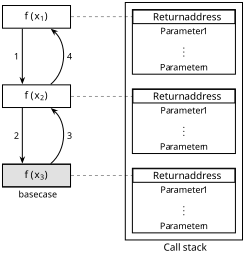

# Worst-case Analysis

## Worst-case Time Complexity

### Calculating the Worst Case

1. Identify the input parameters that influence running time and assign variables (commonly $n$, $m$, $k$, etc.).
2. Break the algorithm into significant parts
3. Assign a cost to each part based on the following methods
4. Combine the costs of sequential parts using the law of addition, and nested parts using the law of multiplication
5. Simplify using the simplification rules

### Primitive Operations

The following primitive operations are worst-case $O(1)$:
- Assigning a value to a variable
- Accessing an element by index or field
- Performing an arithmetic, comparison, or bitwise operation
- Calling or returning from a function

### Iterative Algorithms

1. Identify the **loop variant** of the outermost loop or recursion: the quantity that changes by a predictable amount each iteration/level and has known start and end values. For `for` loops, this is the loop variable itself; for `while` loops, find or invent it (e.g., the gap `right - left` in a two-pointer loop, the search space size in binary search); for recursion, it is the recursion level.
2. For every possible value of the loop variant, determine the cost of one iteration/level as a function of that variant.
3. Sum those costs and express the result as a summation matching the LHS of one of the following formulas, applying properties as needed to massage it into the right form
4. Substitute the RHS of the matching formula to get a closed form, then apply Bachmann-Landau rules to simplify to asymptotic complexity

> [!TIP]
> For step 2, for fixed-limit formulas, if the upper limit does not match the standard formula (e.g. $\sum_{i=0}^{n-1}$ instead of $\sum_{i=1}^{n}$), substitute the upper limit into the formula in place of $n$. However, if the lower limit doesn't match the fixed-limit formula, there are two approaches. If the lower limit is larger than that of the fixed formula, then your sum is missing terms compared to the formula's sum, so you compute the full sum and subtract the prefix you don't want (e.g., $\sum_{i=3}^{n} i = \sum_{i=1}^{n} i - \sum_{i=1}^{2} i = \frac{n(n+1)}{2} - 3$). If the lower limit is smaller than that of the fixed formula, then your sum has extra terms compared to the formula's sum, so you compute the formula's sum and add the extras manually (e.g., $\sum_{i=0}^{n} i = 0 + \sum_{i=1}^{n} i = \frac{n(n+1)}{2}$).

> [!PROPOSITION] Big O and summation
> $$
> \sum_{i \in I} O(f(i)) = O\left(\sum_{i \in I} f(i)\right)
> $$

> [!PROPOSITION] Summation of a constant
> $$
> \sum_{i = m}^{n} ca_i = c \sum_{i = m}^{n} a_i
> $$

> [!PROPOSITION] Addition and subtraction of summations
> $$
> \sum_{i = m}^{n} (a_i \pm b_i) = \sum_{i = m}^{n} a_i \pm \sum_{i = m}^{n} b_i
> $$

> [!PROPOSITION] Summation of a $1$
> $$
> \sum_{i = m}^{n} 1 = n - m + 1
> $$

> [!PROPOSITION] Arithmetic series
> $$
> \sum_{i = 1}^{n} i = \frac{n(n + 1)}{2}
> $$

> [!PROPOSITION] Sum of squares
> $$
> \sum_{i = 1}^{n} i^2 = \frac{n(n + 1)(2n + 1)}{6}
> $$

> [!PROPOSITION] Cubic series
> $$
> \sum_{i = 1}^{n} i^3 = \left(\frac{n(n + 1)}{2}\right)^2
> $$

> [!PROPOSITION] $i^k$ series
> $$
> \sum_{i = 1}^{n} i^k \approx \frac{1}{k + 1}n^{k + 1}
> $$

> [!PROPOSITION] Geometric series
> $$
> \sum_{k = 0}^{n}r^k = \frac{r^{n + 1} - 1}{r - 1}, \text{ where } r > 0 \text{ and } r \neq 1
> $$

> [!PROPOSITION] Harmonic series
> $$
> \sum_{i = 1}^{n} \frac{1}{i} \approx \ln n + \gamma, \text{ where } \gamma \approx 0.5772 \dots
> $$

> [!PROPOSITION] $\log_{2}$ series
> $$
> \sum_{i = 1}^{n} \log_2 i = O\left(\sum_{i = 1}^{n} \log_2 n\right) = O(n\log_2 n)
> $$

### Recursive Algorithms 

In general, to determine the worst-case time complexity of a recursive algorithm:
1. Define a function $T(n)$ representing the time spent by your algorithm to execute an entry of size $n$
2. Write a recursive formula computing $T(n)$
3. Solve the recurrence

The **recursion tree method** solves a recurrence by taking the total number of function calls multiplied by the work done per function call. The total number of functions calls is determined by drawing out the **recursion tree**. 

1. Draw out the recursion tree

2. Determine the branching factor $b$.

3. Figure out the work done per node at level $k$ $W(k)$ which is a function of the subproblem size at that level $k$
    - If dividing by $b$ each time: $W(k) = \frac{n}{b^k}$
    - If decrementing by 1 each time: $W(k) = n - k$
    - If work per node doesn't depend on the subproblem size: $O(1)$

4. Figure out the number of levels $d$

5. Plug into the formula

$$
\sum_{k=0}^{d} W(k) \cdot b^k
$$

> [!TIP]
> On [LeetCode](https://leetcode.com/), assuming limits of $\sim 10^8$ simple operations per second and a 1-second time limit, for problems where all inputs share the _same_ maximum bound, we can typically deduce the slowest time complexity that the judge will tolerate:
> | Max input size $n$ | Slowest time complexity |
> | :---: | :---: |
> | $n \le 10$ | $O(n!)$ |
> | $n \le 20$ | $O(2^n)$ |
> | $n \le 500$ | $O(n^3)$ |
> | $n \le 5000$ | $O(n^2)$ |
> | $n \le 10^6$ | $O(n \log n)$ or $O(n)$ |
> | $n \le 10^8$ | $O(\log n)$ or $O(1)$ |

## Worst-case Space Complexity

- Integers: $O(1)$
- Array based collection or pointer based collection: $O(n)$, where $n$ is the number of elements
- Nested collection: $O(\text{outer collection size} \times \text{inner collection size})$
- Adjacency List: $O(V + E)$, where $V$ is the number of vertices, and $E$ is the number of edges
- Call Stack: $O(d \cdot F)$, where $d$ is maximum recursion depth, and $F$ is the memory consumed per stack frame

### Optimizing Space Complexity

- Whenever the problem space is predetermined, you might be able to use a static array of booleans or values instead of a hashset or a hashmap respectively (e.g., the input consist of vertices labeled `0` to `n - 1`, the input consists of only the 26 letters in the alphabet, etc.).
- For recursive functions, consider rewriting them iteratively or, where appropriate, using tail recursion.
- Perform in-place operations if you won't need the original array values again later on. When reads and writes alias the _same_ memory, iterate in the direction that guarantees every value is read before anything that depends on it gets overwritten.

> [!NOTE]
> In interviews, the algorithm's input _and_ output is typically excluded from the total space complexity cost, and only the auxiliary space is considered.

