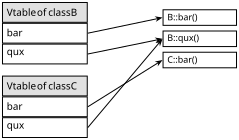
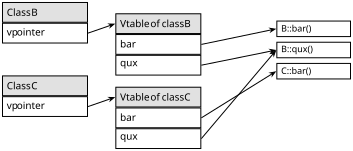

# C

## Entry Point

Every C program must define a function named `main()`, which is the program's entry point.

When the executable is loaded into memory, the operating system transfers control to the **C runtime's startup code**, which sets up `argc`/`argv` and then calls `main()`. On Linux, this is `_start`, from the C library's `crt1.o`, which the linker adds to every program.

The program ends cleanly in three ways:
- When `main()` returns an integer
- When `exit()` is called
- When control reaches the closing brace of `main()`, which is treated as `return 0;` (since C99)

The integer value returned by `main()` is passed back to the operating system as the program's **exit status**, where `0` indicates success.

`main()` must be declared as either:
- `int main(void)`
- `int main(int argc, char **argv)`, where `argv` represents an array of string command-line arguments, and `argc` the number of arguments in `argv`.

```c
#include <stdio.h> // `printf()`

int main(void) {
    printf("Hello, World!\n");
    return 0;
}
```

## Comments

Comments are used to write anything that is to be ignored by the compiler.

```c
/*
 * Multi-line comments
 */

// Single-line comments
```

## Arithmetic Types

| Type | Minimum width |
| :---: | :---: |
| `bool`  | 8 bits, holds only `0` or `1` |
| `char` | 8 bits |
| `signed char` | 8 bits |
| `unsigned char` | 8 bits |
| `signed short int` | 16 bits |
| `unsigned short int` | 16 bits |
| `signed int` | 16 bits |
| `unsigned int` | 16 bits |
| `signed long int` | 32 bits |
| `unsigned long int` | 32 bits (4 bytes) |
| `signed long long int` | 64 bits (8 bytes) |
| `unsigned long long int` | 64 bits (8 bytes) |
| `float` | ~6 decimal digits of precision |
| `double` | ~10 decimal digits of precision |

Integer types follow the general form:

```syntax
<sign>? <size>? int
<sign>? char

<sign>:
    signed
    unsigned
<size>:
    short
    long
    long long
```

> [!TIP]
> - `signed` is the default for every integer type except `char`, so it can be omitted.
> - `int` can be omitted when `signed`, `unsigned`, `short`, `long`, or `long long` is present.
>
> ```c
> // all four declarations name the same type
> signed long int a;
> signed long b;
> long int c;
> long d;
> ```

> [!TIP]
> The standard only fixes the minimum widths; the actual width of each integer type depends on the target platform (architecture, OS, and compiler/ABI). Check a type's size with the [`sizeof` operator](https://beej.us/guide/bgc/html/#sizeof-operator). Alternatively, use fixed-width integers where possible, by including [`<inttypes.h>`](https://beej.us/guide/bgclr/html/#inttypes). It includes [`<stdint.h>`](https://beej.us/guide/bgclr/html/#stdint), which defines the types, and adds the macros to print them (e.g., `PRId32` for `int32_t`).

> [!TIP]
> The signedness of a plain `char` depends on the target platform (architecture, OS, and compiler/ABI). As such, check a `char`'s signedness with `CHAR_MIN` from [`<limits.h>`](https://beej.us/guide/bgclr/html/#limits), which is `0` when `char` is unsigned. Alternatively, explicitly write `signed char` or `unsigned char`.

> [!WARNING]
> C treats a nonzero value as `true`, and a zero value as `false`.

## Objects

An **object** is a region of memory that holds a value of some type.

> [!NOTE]
> This is unrelated to the term object in object-oriented programming.

## Scope

An identifier's **scope** is the part of the code where its name is visible.

### Scope Kinds

- **File scope**: declared outside any block, visible to the end of the translation unit.
- **Block scope**: declared inside `{ }` or as a function parameter, visible to the end of that block.
- **Function prototype scope**: parameter names in a prototype without a body, visible only within that prototype.
- **Function scope**: labels only. A label is visible throughout the whole function, even before it appears.

```c
#include <inttypes.h> // `int32_t`

int32_t total; // `total` has file scope

void g(int32_t n); // `n` has function prototype scope: visible only within `g()`'s declaration

void f(int32_t p) { // `p` has block scope: visible throughout `f()`'s body
    if (p < 0) {
        goto done; // `done` has function scope: usable anywhere in `f()`, even before it appears
    }

    int32_t x = 1; // `x` has block scope: visible from here to the end of `f()`
    if (x) {
        int32_t y = 2; // `y` also has block scope: visible only inside this if statement
    }

done:
    return;
}
```

### Shadowing

An inner variable with the same name as an outer one **shadows** it, hiding the outer one until the inner block ends.

```c
#include <inttypes.h> // `int32_t`

int32_t x = 1; // file-scope `x`

void f(void) {
    int32_t x = 2; // shadows the file-scope `x`
    if (x) {
        int32_t x = 3; // shadows the function's `x`
        x = 4;         // changes only the innermost `x`
    }
    // here `x` is 2 again; the innermost `x` is gone
}
// here `x` is 1; the file-scope `x` was never changed
```

## Storage Duration

An object's **storage duration** is how long its memory exists.

| Storage duration | Created | Destroyed | Starts as |
| :---: | :---: | :---: | :---: |
| Automatic | when the block starts (stack) | when the block ends | garbage |
| Static | when the program starts (`.data`, `.bss`, or `.rodata`) | when the program ends | zero, unless initialized |
| Thread | when the thread starts (`.tdata` or `.tbss`) | when the thread ends | zero, unless initialized |
| Allocated | at `malloc()` | at `free()` | garbage |

## Linkage

An identifier's **linkage** determines whether declarations of the same name in different scopes or files refer to the same object or function.

Scope decides where a name is visible within one file. Linkage decides whether that name connects to the same name in other places, including other files.

> [!NOTE]
> A **translation unit** is one `.c` file after the preprocessor has inserted its `#include`d headers. The compiler compiles each translation unit separately, and the linker joins them into one program.

### Linkage Kinds

| Linkage | Same name refers to the same thing across | Applies to |
| :---: | :---: | :---: |
| External | the whole program, every translation unit | file-scope variables and functions (default) |
| Internal | one translation unit only | file-scope variables and functions declared `static` |
| None | nothing; each declaration is its own object | block-scope variables, function parameters |

```c
// main.c
#include <inttypes.h> // `int32_t`

int32_t total = 0;        // external linkage: visible to other files
static int32_t helper;    // internal linkage: private to main.c

void add(int32_t n);      // external linkage: defined in another file

int main(void) {
    int32_t x = 5;        // no linkage: exists only inside `main()`
    add(x);
    return 0;
}
```

```c
// add.c
#include <inttypes.h> // `int32_t`

extern int32_t total;     // refers to `total` defined in main.c

void add(int32_t n) {     // definition of `add()`
    total += n;
}
```

### Declarations and Definitions

A **declaration** introduces a name and its type. 

A **definition** is a declaration that also creates the object or provides the function's body.

- An identifier with external linkage must have exactly one definition in the whole program, but can have any number of declarations.
- A function prototype without a body is a declaration; with a body, it is a definition.
- A file-scope variable is a definition unless it is marked `extern` and has no initializer.

## Variables

A **variable** is a named object.

```syntax
<storage class>? <qualifier>? <type> <identifier> <initializer>?;

<storage class>:
    static
    extern
    constexpr       (C23)
    thread_local    (C23; `_Thread_local` in C11)
<qualifier>:
    const
    volatile
<initializer>:
    = <value>
```

Qualifiers and storage classes are covered in their own sections below. Without them, a variable is either a local or a global variable, depending on where it is declared.

A variable can be declared with or without an initializer, and several variables of the same type can be declared on one line.

```c
#include <inttypes.h> // `int32_t`

int main(void) {
    // declaration
    int32_t count; // starts as garbage

    // declaration with initialization
    int32_t total = 0;

    // multiple declarations on one line; only `a` is initialized
    char a = 'x', b;
}
```

A variable can also be assigned after it is declared.

```c
#include <inttypes.h> // `int32_t`

int main(void) {
    int32_t foo = 0; // initialized
    foo = 5;         // assigned
}
```

> [!NOTE]
> Assignment is a statement, so it can only appear inside a function. At file scope, a variable can only get a value through its initializer.

### Local Variables

A **local variable** is a variable with the following properties:
- **Scope**: block
- **Storage duration**: automatic
- **Linkage**: none

```c
#include <stdio.h>    // `printf()`
#include <inttypes.h> // `PRId32`, `int32_t`

void tick(void) {
    int32_t count = 0; // created and set to 0 on every call
    count += 1;
    printf("%" PRId32 "\n", count);
} // `count` is destroyed here

int main(void) {
    tick(); // 1
    tick(); // 1
}
```

### Global Variables

A **global variable** is a variable with the following properties:
- **Scope**: file
- **Storage duration**: static
- **Linkage**: external

```c
#include <stdio.h>    // `printf()`
#include <inttypes.h> // `PRId32`, `int32_t`

int32_t count; // starts at 0, shared by every function in the program

void tick(void) {
    count += 1;
}

int main(void) {
    tick();
    tick();
    printf("%" PRId32 "\n", count); // 2
}
```

> [!NOTE]
> Not every variable declaration inside a block is a local variable. A `static` or `thread_local` declaration has a different storage duration, and an `extern` declaration creates no object, but refers to a global instead.

## Qualifiers

A **qualifier** is part of a type, and changes how an object of that type can be accessed. Since it is part of the type, it can appear anywhere a type does: on variables, function parameters, pointer targets, and struct members.

### `const`

An object declared `const` is read-only: it can't be assigned after it is declared, so it gets its value from its initializer.

```c
#include <inttypes.h> // `int32_t`

const int32_t max = 100; // const global

void print(const char *text); // `print()` promises not to modify the string

int main(void) {
    const int32_t limit = 10; // const local
    limit = 20;               // error: `limit` is read-only
}
```

> [!WARNING]
> A `const` variable is _not_ a constant expression, so it can't be used where the compiler needs a value at compile time:
>
> ```c
> const int32_t size = 16;
>
> int32_t buffer[size]; // error at file scope; a variable-length array at block scope
>
> switch (x) {
>     case size:        // error: not a constant expression
>         break;
> }
> ```
>
> Use `constexpr` (C23), `enum`, or `#define` for true constants.

> [!NOTE]
> Unlike C++, `const` doesn't change linkage in C: a `const` global still has external linkage.

Where `const` appears relative to `*` decides what is read-only.

```c
#include <inttypes.h> // `int32_t`

int main(void) {
    int32_t x = 1, y = 2;

    const int32_t *p = &x;       // pointer to const: `*p = 5;` is an error, `p = &y;` is fine
    int32_t *const q = &x;       // const pointer: `*q = 5;` is fine, `q = &y;` is an error
    const int32_t *const r = &x; // both: `*r = 5;` and `r = &y;` are errors
}
```

### `volatile`

An object declared `volatile` may change outside the program's normal flow, such as in a signal handler or a hardware register. The compiler must perform every read and write as written, instead of optimizing them away.

```c
#include <signal.h> // `sig_atomic_t`

volatile sig_atomic_t stop = 0; // may be set by a signal handler

int main(void) {
    while (!stop) {
        // without `volatile`, the compiler could read `stop` once and loop forever
    }
}
```

> [!WARNING]
> `volatile` does not make an object safe to share between threads. Use atomics (`<stdatomic.h>`) or locks for that.

## Storage Classes

A **storage class** sets properties of a declaration other than its type: its storage duration, its linkage, or whether it creates an object at all.

### `static`

What `static` changes depends on where it is declared.

#### `static` local variables

A local variable declared `static` has its storage duration changed to static.

As a result, it keeps its value between calls:

```c
#include <stdio.h>    // `printf()`
#include <inttypes.h> // `PRId32`, `int32_t`

void tick(void) {
    static int32_t count; // starts at 0, initialized only once
    count += 1;
    printf("%" PRId32 "\n", count);
}

int main(void) {
    tick(); // 1
    tick(); // 2
}
```

> [!NOTE]
> There is only one copy of a `static` local variable, shared by every call of its function, including recursive calls.

#### `static` global variables

A global variable declared `static` has its linkage changed to internal.

As a result, it is private to its translation unit, and other files can reuse its name without clashing:

```c
// counter.c
#include <inttypes.h> // `int32_t`

static int32_t count; // visible only inside counter.c

void tick(void) {
    count += 1;
}
```

```c
// main.c
#include <inttypes.h> // `int32_t`

static int32_t count; // a different `count`, private to main.c

void tick(void);

int main(void) {
    tick(); // changes counter.c's `count`, not this one
}
```

### `extern`

A variable declared `extern` is a declaration only, which means it creates no object, and refers to a global variable defined elsewhere, usually in another translation unit. 

```c
// counter.c
#include <inttypes.h> // `int32_t`

int32_t count = 0; // definition: creates the object
```

```c
// main.c
#include <stdio.h>    // `printf()`
#include <inttypes.h> // `PRId32`, `int32_t`

extern int32_t count; // declaration: refers to counter.c's `count`

int main(void) {
    count += 1;
    printf("%" PRId32 "\n", count); // 1
}
```

> [!NOTE]
> `extern` can also appear inside a block. It still refers to a global, but the name is only visible until the end of that block. It can't have an initializer there.

> [!WARNING]
> At file scope, giving an `extern` declaration an initializer turns it into a definition. Since `#include` copies a header's contents into every file that includes it, a definition in a header becomes one definition per file, and linking fails with a multiple definition error.
>
> ```c
> // counter.h
> extern int32_t count = 0; // unintentionally a definition!
> ```
>
> ```c
> // main.c
> #include "counter.h" // defines `count`
> ```
>
> ```c
> // counter.c
> #include "counter.h" // defines `count` again (results in multiple definition linker error)
> ```

> [!TIP]
> Put `extern` declarations in a header file and `#include` it wherever the variable is used, so every file agrees on its type.

### `thread_local`

A variable declared `thread_local` has thread storage duration: each thread gets its own copy, created when the thread starts and destroyed when it ends.

```c
#include <inttypes.h> // `int32_t`

thread_local int32_t errors; // each thread has its own `errors`, starting at 0
```

> [!NOTE]
> Before C23, write `_Thread_local`, or include `<threads.h>` to use the `thread_local` macro. Inside a block, `thread_local` must be combined with `static` or `extern`.

### `constexpr`

A variable declared `constexpr` (C23) is a **compile-time constant**.

This means its initializer must be a constant expression, and it is implicitly `const`.

Unlike `const`, it can be used where the compiler needs a value at compile time, such as array sizes and `case` labels.

```c
#include <inttypes.h> // `int32_t`

constexpr int32_t size = 16; // global compile-time constant

int32_t buffer[size]; // OK: `size` is a constant expression

int main(void) {
    constexpr int32_t limit = 4; // local compile-time constant

    switch (buffer[0]) {
        case limit: // OK: usable as a `case` label
            break;
    }

    int32_t n = 3;
    constexpr int32_t bad = n; // error: `n` is not a constant expression
}
```

> [!NOTE]
> `constexpr` only applies to variables: not to functions, parameters, or struct members.

## Pointers

> [!TIP]
> Read pointer declarations right to left. For instance, `int32_t *const q` reading right to left can be read as "`q` is a const pointer to `int32_t`."

## Object-Oriented Programming

### Abstraction 

**Abstraction** representing something by its essential behavior, so users can depend on _what_ it does rather than _how_ it does it.
_In OOP, this is achieved through interfaces, abstract classes, and public methods named and designed around what an object does._

We use Abstraction to reduce complexity.

### Encapsulation

**Encapsulation:** keeping a thing's internal state under its own control, so nothing outside can put it into an invalid condition.
_In OOP, this is achieved by bundling data and the methods that operate on it into a class, and using access modifiers (like `private`) to block direct outside access to that data._

We use encapsulation to protect state.

### Inheritance & Composition

**Inheritance:** defining a new kind of thing as a specialized version of an existing one, so it automatically has everything the original has and can extend or change it. It models an _is-a_ relationship: a `Dog` _is an_ `Animal`.
_In OOP, this is achieved by having a subclass extend a superclass, inheriting its fields and methods and optionally overriding some of them._

**Composition:** building a thing out of other things, so it gains their capabilities by containing them rather than by being them. It models a _has-a_ relationship: a `Car` _has an_ `Engine`.
_In OOP, this is achieved by giving a class fields that hold other objects and having it delegate work to them by calling their methods._

We use inheritance or composition to reuse by being or having. 

### Polymorphism

**Definition:** treating different kinds of things uniformly through a shared interface, while each one responds in its own way.

Polymorphism lets one piece of code work with many types.

This is achieved either statically, where the compiler picks the version from declared types (overloading, generics), or dynamically, where the runtime picks it from the actual object (overriding, interfaces).

When working with inheritance hierarchies, you often need to convert between base and derived types. 

**Upcasting** is converting a derived type to its base type, while **downcasting** is converting a base type to a derived type.

Upcasting is implicit and always safe because a derived class is guaranteed to have everything the base class has:

```java
Dog myDog = new Dog();
Animal animal = myDog;  
```

Downcasting requires an explicit cast and can fail at runtime if the object isn't actually the type you're casting to:

```java
Animal animal = new Dog();
Dog dog = (Dog) animal;  // works because it's really a Dog

Animal cat = new Cat();
Dog wrong = (Dog) cat;   // Throws `InvalidCastException`
```

```cpp
#include <iostream>
#include <memory>

class B {
public:
    virtual ~B() = default;  // safe deletion through a B*

    virtual void bar() const;
    virtual void qux() const;
};

void B::bar() const {
    std::cout << "This is B's implementation of bar\n";
}

void B::qux() const {
    std::cout << "This is B's implementation of qux\n";
}

class C : public B {
public:
    void bar() const override;
};

void C::bar() const {
    std::cout << "This is C's implementation of bar\n";
}

int main() {
    // unique_ptr deletes the object automatically, so nothing leaks
    std::unique_ptr<B> b = std::make_unique<C>();

    // Follows the object's vptr to C's vtable: calls C::bar
    b->bar();

    // C doesn't override qux, so C's vtable points to B::qux
    b->qux();
}
```

If we use static dispatch as above, the call b->bar() would execute B::bar(), since (from the point of view of the compiler) b points to an object of type B.

For every class that contains virtual functions, the compiler constructs a virtual table, a.k.a vtable. The vtable contains an entry for each virtual function accessible by the class and stores a pointer to its definition. Only the most specific function definition callable by the class is stored in the vtable. Entries in the vtable can point to either functions declared in the class itself (e.g. C::bar()), or virtual functions inherited from a base class (e.g. C::qux()).



Every time the compiler creates a vtable for a class, it adds an extra argument to it: a pointer to the corresponding virtual table, called the vpointer.



Note that the vpointer is just another class member added by the compiler and increases the size of every object that has a vtable by sizeof(vpointer).

Dynamic function dispatch can be implemented using vtables. When a virtual function is called on an object, the object’s vpointer is used to find the vtable of its actual class. At compile time, the compiler has already assigned each virtual function a fixed slot in the vtable. The call then reads the function pointer stored in that slot, which points to the most specific override (the version of the function defined furthest down the inheritance chain, counting from the base class to the object’s actual type), and calls it.

Always declare desctructors of base classes as virtual

```cpp
#include <iostream>

class Base {
public:
    ~Base() {
        std::cout << "Destroying base\n";
    }
};

class Derived : public Base {
public:
    explicit Derived(int number) : some_resource_(new int(number)) {}

    ~Derived() {
        std::cout << "Destroying derived\n";
        delete some_resource_;
    }

private:
    int* some_resource_;
};

int main() {
    Base* p = new Derived(5);
    delete p;  // Base's destructor isn't virtual, so `~Derived()` never runs
}
```

This outputs only:

```text
Destroying base
```

Making `Base`'s destructor `virtual` gives the expected behavior:

```text
Destroying derived
Destroying base
```

```c
// Minimal vtable example in C23.
// Build: gcc -std=c23 -Wall -Wextra -pedantic shapes.c -o shapes -lm

#include <stddef.h>
#include <stdio.h>
#include <stdlib.h>

constexpr double PI = 3.14159265358979323846;

typedef struct Shape Shape;

// One table of function pointers per derived type.
// Every entry takes the base type, so all types share one layout.
typedef struct {
    const char *name;
    double (*area)(const Shape *self);
    double (*perimeter)(const Shape *self);
} ShapeVTable;

// The base object holds only a pointer to its type's vtable.
struct Shape {
    const ShapeVTable *vt;
};

// Public interface: callers use these and never touch vt directly.
static inline const char *shape_name(const Shape *s)      { return s->vt->name; }
static inline double      shape_area(const Shape *s)      { return s->vt->area(s); }
static inline double      shape_perimeter(const Shape *s) { return s->vt->perimeter(s); }
static inline void        shape_free(Shape *s)            { free(s); }

// ============================================================
// Circle
// ============================================================

typedef struct {
    Shape  base;   // must be first, so a Circle * and its Shape * are the same address
    double radius;
} Circle;

static_assert(offsetof(Circle, base) == 0, "base must be the first member");

// The one place a Shape * becomes a Circle *.
static inline const Circle *as_circle(const Shape *s) { return (const Circle *)s; }

static double circle_area(const Shape *s) {
    const Circle *c = as_circle(s);
    return PI * c->radius * c->radius;
}

static double circle_perimeter(const Shape *s) {
    const Circle *c = as_circle(s);
    return 2.0 * PI * c->radius;
}

static const ShapeVTable CIRCLE_VT = {
    .name      = "Circle",
    .area      = circle_area,
    .perimeter = circle_perimeter,
};

[[nodiscard]] Shape *circle_new(double radius) {
    Circle *c = malloc(sizeof *c);
    if (c == nullptr) {
        return nullptr;
    }
    *c = (Circle){ .base = { .vt = &CIRCLE_VT }, .radius = radius };
    return &c->base;
}

// ============================================================
// Rectangle
// ============================================================

typedef struct {
    Shape  base;   // must be first
    double w, h;
} Rectangle;

static_assert(offsetof(Rectangle, base) == 0, "base must be the first member");

static inline const Rectangle *as_rectangle(const Shape *s) { return (const Rectangle *)s; }

static double rectangle_area(const Shape *s) {
    const Rectangle *r = as_rectangle(s);
    return r->w * r->h;
}

static double rectangle_perimeter(const Shape *s) {
    const Rectangle *r = as_rectangle(s);
    return 2.0 * (r->w + r->h);
}

static const ShapeVTable RECTANGLE_VT = {
    .name      = "Rectangle",
    .area      = rectangle_area,
    .perimeter = rectangle_perimeter,
};

[[nodiscard]] Shape *rectangle_new(double w, double h) {
    Rectangle *r = malloc(sizeof *r);
    if (r == nullptr) {
        return nullptr;
    }
    *r = (Rectangle){ .base = { .vt = &RECTANGLE_VT }, .w = w, .h = h };
    return &r->base;
}

// ============================================================
// Demo
// ============================================================

int main(void) {
    Shape *shapes[] = {
        circle_new(1.0),
        rectangle_new(3.0, 4.0),
        circle_new(0.5),
    };
    constexpr size_t n = sizeof shapes / sizeof shapes[0];

    int status = EXIT_SUCCESS;

    for (size_t i = 0; i < n; i++) {
        if (shapes[i] == nullptr) {
            fprintf(stderr, "allocation failed\n");
            status = EXIT_FAILURE;
            goto cleanup;
        }
    }

    // The loop knows nothing about Circle or Rectangle.
    for (size_t i = 0; i < n; i++) {
        printf("%-10s area = %7.3f  perimeter = %7.3f\n",
               shape_name(shapes[i]),
               shape_area(shapes[i]),
               shape_perimeter(shapes[i]));
    }

cleanup:
    for (size_t i = 0; i < n; i++) {
        shape_free(shapes[i]);   // free(nullptr) is a no-op
    }
    return status;
}
```

<!-- #### `extern`

An `extern` declaration inside a block creates a declaration for a global variable visible by name, but only inside that block. 

It's definition must be a global variable defined elsewhere.

```c
#include <inttypes.h> // `int32_t`

void f(void) {
    extern int32_t counter; // the global counter, visible only inside `f()`
    counter += 1;
}
```

#### `const`

A local variable declared `const` is read-only after its initialization, which means it can't be re-assigned. 

Its initializer can be any compile time or run time known expression.

```c
#include <inttypes.h> // `int32_t`

void f(void) {
    const int32_t n = get_count(); // fixed at run time
    n = 5; // error, n is const
}
```

#### `constexpr`

Its initializer must be a constant expression, and in return it can be used where C requires one, such as an array size. 

It is implicitly `const`, i.e., it can't be re-assigned.

```c
#include <stddef.h>   // `size_t`
#include <inttypes.h> // `int32_t`

void f(void) {
    constexpr size_t size = 16; // fixed at compile time
    int32_t buf[size];          // works, size is a constant expression
}
```

### Global Variables

A **global variable** is a variable declared outside any function. 

- Scope: file scope
- Storage Duration: static

#### `static`

Declaring a global variable `static` keeps it private to the file it is declared in. 

```c
#include <inttypes.h> // int32_t

int32_t shared;           // other .c files can use it
static int32_t file_only; // invisible to other .c files
```

#### `extern`

An `extern` declaration refers to a global variable that is defined in another file, without creating it. Exactly one file defines it, and every other file that uses it declares it with `extern`, usually through a header.

```c
#include <inttypes.h> // int32_t

// counter.c
int32_t counter = 0; // definition

// main.c
extern int32_t counter; // declaration, the storage is in counter.c
```

> [!NOTE]
> The usual practice of `extern` is to put an `extern` declaration in a header at file scope. Then, include that header, and define the object in exactly one `.c` file. 

#### `const`

A global variable declared [`const`](#const-local-variables) is still visible to other files. Defining it in a header gives every file that includes it its own definition of the same name, so linking fails with a duplicate definition. Either declare it `static const` so each file gets a private copy, or define it in one `.c` file and declare it `extern const` in the header.

```c
#include <inttypes.h> // int32_t

// users.h
extern const int32_t max_users; // declaration only

// users.c
const int32_t max_users = 100;  // the one definition
```

#### `constexpr`

A global variable declared [`constexpr`](#constexpr-local-variables) is private to its file, as if it were also declared `static`. This makes it safe to define in a header: every file that includes it gets its own copy, with no duplicate definition at link time. It can't be declared `extern`, since its value must be visible wherever it is used.

```c
#include <inttypes.h> // int32_t

// config.h
constexpr int32_t max_items = 64; // each including file gets its own copy
```

> [!WARNING]
> Identifiers are case sensitive. This means `foo` and `FOO` are two different identifiers.

## Expressions

An **expression** is anything that produces a value, such as `x + 1`, `a < b` or `f()`.

> [!NOTE]
> Adding a `;` after any expression turns it into a **statement**. `x = 5;` and `f();` are expression statements, and so is `x + 1;`, which computes a value and throws it away.

### Arithmetic

| Operator | Description |
| :---: | :---: |
| `+` | Addition |
| `-` | Subtraction |
| `*` | Multiplication |
| `/` | Division that rounds toward zero (i.e., truncates the fraction) |
| `%` | Remainder (i.e., takes the sign of the dividend) |
| `+x` | Unary plus (i.e., gives `x` unchanged) |
| `-x` | Negation |
| `x++` | Post-increment: adds 1 to `x`, and gives the old value |
| `x--` | Post-decrement: subtracts 1 from `x`, and gives the old value |
| `++x` | Pre-increment: adds 1 to `x`, and gives the new value |
| `--x` | Pre-decrement: subtracts 1 from `x`, and gives the new value |

```c
#include <inttypes.h> // int32_t

int32_t a = 7 + 2; // 9, addition
int32_t b = 7 - 2; // 5, subtraction
int32_t c = 7 * 2; // 14, multiplication
int32_t d = 7 / 2; // 3, division
int32_t e = 7 % 2; // 1, remainder
```

```c
#include <inttypes.h> // int32_t

int32_t i = 5;
int32_t x = i++; // x is 5, i is 6

int32_t j = 5;
int32_t y = ++j; // y is 6, j is 6
```

```c
7 / 2;  // 3
7 % 2;  // 1

-7 / 2; // -3, since -3.5 rounded toward zero 
-7 % 2; // -1, since -7 is negative

7 / -2 // -3, since -3.5 rounded toward zero 
7 % -2 // 1, since 7 is positive
```

> [!NOTE]
> Arithmetic operators from highest to lowest precedence. Parentheses go first, and operators on the same row group by their associativity.
>
> | Precedence | Operators | Associativity |
> | :---: | :---: | :---: |
> | 1 | `x++`, `x--` | left to right |
> | 2 | `++x`, `--x`, unary `+x`, `-x` | right to left |
> | 3 | `*`, `/`, `%` | left to right |
> | 4 | `+`, `-` | left to right |
>
> ```c
> #include <inttypes.h> // int32_t
>
> int32_t f = 7 + 2 * 3;   // 13
> int32_t g = (7 + 2) * 3; // 27
> int32_t h = 10 - 4 - 3;  // 3, (10 - 4) - 3
> ```

> [!NOTE]
> Division and modulo always come as a pair that satisfies the identity:
>
> $$x = q \cdot n + r$$
>
> where $q$ is the quotient ($x \operatorname{div} n$) and $r$ is the remainder ($x \bmod n$).
>
> This means that defining one of the two operations fully determines the other. Once $x$ and $n$ are fixed, the identity ties $q$ and $r$ together, so choosing either one decides the other:
>
> - **Define $q$ (division), and $r$ follows:** $r = x - q \cdot n$
> - **Define $r$ (modulo), and $q$ follows:** $q = (x - r) / n$
>
> We can define division in five ways. The first four pick a rounding rule for $q$, and the range of $r$ follows from the identity. The fifth, **Euclidean**, starts from the range of $r$ instead, and $q$ is whatever the identity then forces.
>
> | Rule | $q$ | $r$ |
> | :---: | :---: | :---: |
> | Ceil | round up | $r \in \begin{cases} (-n, \, 0] & n > 0 \\ [0, \, \lvert n \rvert) & n < 0 \end{cases}$ |
> | Floor | round down | $r \in \begin{cases} [0, \, n) & n > 0 \\ (n, \, 0] & n < 0 \end{cases}$ |
> | Round | round to nearest | $r \in [-\lvert n \rvert/2, \, \lvert n \rvert/2]$ |
> | Truncate | round toward zero | $r \in \begin{cases} [0, \, \lvert n \rvert) & x \ge 0 \\ (-\lvert n \rvert, \, 0] & x < 0 \end{cases}$ |
> | Euclidean | $\begin{cases} \text{round down} & n > 0 \\ \text{round up} & n < 0 \end{cases}$ | $r \in [0, \, \lvert n \rvert)$ |
>
> Of the five, floor and Euclidean are the most useful, because when $n > 0$ both give $r \in [0, n)$, even for negative $x$. That makes their remainder a valid index for wrap-around, as in circular arrays. 
> 
> As such, floor is often preferred because it's simpler than Euclidean division (i.e., it's just $\lfloor x/n \rfloor$), and the floor modulo can easily calculate the Euclidean remainder via $x \bmod \lvert n \rvert$.

> [!TIP]
> To get floored division and floored modulo, assuming `n > 0`:
>
> ```c
> #include <inttypes.h> // int32_t
>
> int32_t div_floor(int32_t x, int32_t n) {
>     int32_t q = x / n;
>     if (x % n < 0) {
>         q -= 1;
>     }
>     return q;
> }
>
> int32_t mod_floor(int32_t x, int32_t n) {
>     int32_t r = x % n;
>     if (r < 0) {
>         r += n;
>     }
>     return r;
> }
> ```

### Boolean

Relational operators compare two values, and logical operators combine conditions. Both give an `int`: `1` for true and `0` for false.

| Operator | Description |
| :---: | :---: |
| `==` | Equal to |
| `!=` | Not equal to |
| `<` | Less than |
| `>` | Greater than |
| `<=` | Less than or equal to |
| `>=` | Greater than or equal to |

| Operator | Description |
| :---: | :---: |
| `&&` | Logical AND: true if both sides are true |
| `\|\|` | Logical OR: true if either side is true |
| `!` | Logical NOT: true if the operand is false |

```c
bool in_range = x >= 0 && x < 10;
bool not_zero = !(x == 0);
```

> [!NOTE]
> `&&` and `||` short-circuit, so the right side only runs when the left side doesn't already decide the result.
>
> ```c
> if (p != nullptr && *p > 0) { ... } // *p is never read when p is null
> ```

> [!TIP]
> To negate a combined condition, apply two separate rules in order:
>
> 1. **De Morgan's laws** move the $\lnot$ onto each part, and swap $\land$ and $\lor$:
>
>    $$\lnot (a \land b) = \lnot a \lor \lnot b \qquad \lnot (a \lor b) = \lnot a \land \lnot b$$
>
> 2. **Each negated comparison becomes its opposite:**
>
>    $$\lnot(x < y) = x \ge y \qquad \lnot(x > y) = x \le y \qquad \lnot(x = y) = x \ne y$$
>
> For example:
>
> $$
> \begin{aligned}
> \lnot (x \ge 0 \land x < 10) &= \lnot(x \ge 0) \lor \lnot(x < 10) && \text{step 1} \\
> &= x < 0 \lor x \ge 10 && \text{step 2}
> \end{aligned}
> $$
>
> More examples:
>
> $$
> \begin{aligned}
> \lnot (x = 0 \lor y = 0) &= x \ne 0 \land y \ne 0 \\
> \lnot (a > b \land c \le d) &= a \le b \lor c > d \\
> \lnot (\lnot a \lor b) &= a \land \lnot b \\
> \lnot (a \land (b \lor c)) &= \lnot a \lor (\lnot b \land \lnot c)
> \end{aligned}
> $$
>
> Step 2 doesn't hold for floating-point values that may be NaN (e.g., from `0.0 / 0.0`). NaN isn't less than, equal to or greater than anything, so `<`, `<=`, `>`, `>=` and `==` with NaN are all false (and `!=` is true). If `x` is NaN, `!(x < y)` is true but `x >= y` is false.

### Bitwise

Bitwise operators work on the individual bits of integers. See [Bitwise Operators](../computer-systems/computer-organization/data-representation.md#bitwise-operations) for truth tables, bit masks and common operations.

| Operator | Description |
| :---: | :---: |
| `&` | Bitwise AND |
| `\|` | Bitwise OR |
| `^` | Bitwise XOR |
| `~` | Bitwise NOT |
| `<<` | Left shift |
| `>>` | Right shift |

```c
#include <inttypes.h> // int32_t

uint32_t flags = 0b0101;
flags & 0b0001; // 1, the lowest bit is set
flags | 0b0010; // 0b0111, set a bit
flags << 1;     // 0b1010, each shift left doubles the value
```

> [!WARNING]
> Bitwise operators have low precedence, so parenthesize them whenever they're mixed with other operators.

> [!WARNING]
> A shift happens in the type of its _left_ operand, after promotion: types narrower than `int` (e.g., `char`, `uint8_t`) are promoted to signed `int` first. This leads to undefined behaviour in two cases:
> - The shift amount is negative, or at least the width of the left operand (e.g., `1u << 32` for a 32-bit `unsigned`).
> - A signed value is shifted left into or past the sign bit, or a negative value is shifted left (e.g., `1 << 31` for a 32-bit `int`).
>
> Additionally, right-shifting a negative value is also implementation-defined (usually an arithmetic shift). 
> 
> To avoid all of these, shift unsigned fixed-width types that are wide enough (e.g., `(uint32_t) x << k` or `1u << k`), and keep `k` within the width.

### Assignment

`=` stores a value in a variable. Every arithmetic and bitwise operator also has a compound form that applies the operator to the variable itself.

| Operator | Same as |
| :---: | :---: |
| `x = y` | assigns `y` to `x` |
| `x += y` | `x = x + y` |
| `x -= y` | `x = x - y` |
| `x *= y` | `x = x * y` |
| `x /= y` | `x = x / y` |
| `x %= y` | `x = x % y` |
| `x &= y` | `x = x & y` |
| `x \|= y` | `x = x \| y` |
| `x ^= y` | `x = x ^ y` |
| `x <<= y` | `x = x << y` |
| `x >>= y` | `x = x >> y` |

```c
#include <inttypes.h> // int32_t

int32_t x = 10;
x += 5;  // same as x = x + 5
x <<= 1; // same as x = x << 1
```

Since an assignment is itself an expression that gives the assigned value, it can be used inside other expressions.

```c
#include <stdio.h> // getchar(), EOF

a = b = 0;                     // (b = 0) gives 0, which is then assigned to a
while ((c = getchar()) != EOF) // assign, then compare the assigned value
if (x = 0)                     // compiles: assigns 0, then tests 0, so it is always false
```

### Type Casts

A type cast takes the form:

```syntax
(<type>) <expression>
```

A cast converts a value to another type

```c
#include <inttypes.h> // int32_t

int32_t a = 7;
int32_t b = 2;
double d = (double) a / b; // 3.5, not 3.0
```

### Ternary Operator

A ternary operator takes the form:

```syntax
<condition> ? <value if true> : <value if false>
```

It picks one of two values, like a short if-else that gives a result.

```c
#include <inttypes.h> // int32_t

int32_t max = a > b ? a : b;
```

## If Statements

An if statement takes the form:

```syntax
if (<condition>) <statement>
if (<condition>) <statement> else <statement>
```

## Switch Statements

A switch statement jumps to a matching value. 

It takes the form:

```syntax
switch (<expression>) { <case>+ <default case>? }

<case>:
    case <constant>: <statements>
<default case>:
    default: <statements>
```

The expression must be an integer (including a `char` or an enum), and each `case` must be a constant.

`default` runs when no case matches. It is optional, and without it a switch with no matching case does nothing. It is usually written last, but it can go anywhere, and it falls through like any other case.

```c
#include <stdio.h>    // printf()
#include <inttypes.h> // int32_t

int main(void) {
    int32_t day = 6;
    switch (day) {
    case 0:
        printf("Sunday\n");
        break;
    case 6:
        printf("Saturday\n");
        break;
    default:
        printf("Weekday\n");
    }
}
```

Without a `break`, execution **falls through** into the next case and keeps going until a `break` or the end of the switch. This lets several cases share the same code.

```c
#include <stdio.h> // printf()

int main(void) {
    char c = 'e';
    switch (c) {
    case 'a':
    case 'e':
    case 'i':
    case 'o':
    case 'u':
        printf("vowel\n");
        break;
    default:
        printf("consonant\n");
    }
}
```

To fall through on purpose after a case that has code, mark it with `[[fallthrough]];` (C23). This tells readers it isn't a missing `break`, and silences the compiler's `-Wimplicit-fallthrough` warning.

```c
#include <stdio.h>    // printf()
#include <inttypes.h> // int32_t

int main(void) {
    int32_t level = 2;
    switch (level) {
    case 2:
        printf("debug\n");
        [[fallthrough]]; // also print everything below
    case 1:
        printf("info\n");
        break;
    default:
        printf("quiet\n");
    }
}
```

> [!WARNING]
> A forgotten `break` silently runs the next case too.

## Loops

### While Loops

A while loop takes the form:

```syntax
while (<condition>) <statement>
```

do-while loop takes the form:

```syntax
do <statement> while (<condition>);
```

### For Loops

A for loop takes the form:

```syntax
for (<init>?; <condition>?; <update>?) <statement>
```

## Functions

```syntax
<return type> <identifier>(<parameters>)

<parameters>:
    void
    <parameter>+,
<parameter>:
    <type> <name>?
```

A **declaration** gives a function's name, return type and parameter types. A **definition** also gives its body, which creates the function. A function can be declared many times but defined only once.

A function header that receives an array's address takes either form:

```syntax
<return type> <identifier>(<type> <array>[])
<return type> <identifier>(<type> *<array>)
```

### File-Scoped Functions

Like a [static global variable](#static-global-variables), a function declared `static` can only be called from its own file. This is how helper functions stay private to the file that uses them.

```c
#include <inttypes.h> // int32_t

static int32_t clamp(int32_t x, int32_t lo, int32_t hi) { // only this file can call clamp
    return x < lo ? lo : x > hi ? hi : x;
}
```

### External Functions

Functions are `extern` by default, so any file can call a function defined in another, as long as it sees a declaration. The declaration usually comes from a header.

```c
// add.c
#include <inttypes.h> // int32_t

int32_t add(int32_t a, int32_t b) { // definition
    return a + b;
}
```

```c
// add.h
#include <inttypes.h> // int32_t

int32_t add(int32_t a, int32_t b); // declaration, same as extern int32_t add(int32_t a, int32_t b);
```

```c
// main.c
#include "add.h" // add()

int main(void) {
    return add(1, 2);
}
```

### Function Pointers

A function pointer declaration takes the form:

```syntax
<return type> (*<identifier>)(<parameters>)
```

### Closures

A **closure** is a function bundled with variables it captured from where it was created. C has no anonymous functions or closures, and a function pointer carries no data, so C code pairs it with the data explicitly. There are two common ways to do it.

#### Context Pointers

The function takes an extra `void *` parameter, and the caller passes the captured state through it. Most C APIs that take a callback use this form, e.g. `pthread_create(..., fn, arg)`, POSIX's `qsort_r()` and GLib's `user_data`.

```c
#include <stdio.h>    // printf()
#include <stddef.h>   // size_t
#include <inttypes.h> // PRId32, int32_t

// the "lambda", with its captured state passed through ctx
static void add_offset(int32_t *x, void *ctx) {
    *x += *(int32_t *)ctx;
}

static void for_each(int32_t *a, size_t n, void (*f)(int32_t *, void *), void *ctx) {
    for (size_t i = 0; i < n; i += 1) {
        f(&a[i], ctx);
    }
}

int main(void) {
    int32_t a[] = {1, 2, 3};
    int32_t offset = 10; // the "captured" variable
    for_each(a, sizeof a / sizeof a[0], add_offset, &offset);
    printf("%" PRId32 "\n", a[0]); // 11
}
```

#### Closure Structs

A struct holds the function pointer, and a larger struct embeds it as its first member next to the captured variables. The function receives the struct itself, so it reaches its own data without a `void *` cast. This is an object with a single method, much like what a C++ lambda compiles to.

```c
#include <stdio.h>    // printf()
#include <inttypes.h> // PRId32, int32_t

struct int_fn {
    int32_t (*call)(struct int_fn *self, int32_t x);
};

struct adder {
    struct int_fn base; // the closure's interface
    int32_t offset;     // its captured variable
};

static int32_t adder_call(struct int_fn *self, int32_t x) {
    struct adder *a = (struct adder *)self; // base is the first member
    return x + a->offset;
}

static int32_t apply_twice(struct int_fn *f, int32_t x) {
    return f->call(f, f->call(f, x));
}

int main(void) {
    struct adder add10 = { .base = { adder_call }, .offset = 10 };
    printf("%" PRId32 "\n", apply_twice(&add10.base, 1)); // 21
}
```

Prefer a context pointer when calling an existing API, and a closure struct when closures are stored and passed around, since it keeps the types checked.

> [!WARNING]
> Neither form owns the captured data. If it lives on the stack, the closure
> dangles once that function returns, the same as a [slice](#fat-pointers).

### Optional And Named Arguments

C has no default or named arguments, but a function can take a single struct instead, and a macro can build that struct from [designated initializers](#designated-initializers). The caller then names only the arguments it cares about, in any order, and every member it leaves out is zero.

```c
#include <stdio.h>    // printf()
#include <inttypes.h> // PRId32, int32_t

struct draw_opts {
    int32_t x;
    int32_t y;
    int32_t width;     // 0 means the default, 1
    const char *color; // nullptr means the default, "black"
};

static void draw_impl(struct draw_opts o) {
    if (o.width == 0) {
        o.width = 1;
    }
    if (o.color == nullptr) {
        o.color = "black";
    }
    printf("(%" PRId32 ", %" PRId32 ") width %" PRId32 " %s\n", o.x, o.y, o.width, o.color);
}

#define draw(...) draw_impl((struct draw_opts){ __VA_ARGS__ })

int main(void) {
    draw(.x = 1, .y = 2);                 // (1, 2) width 1 black
    draw(.color = "red", .x = 3, .y = 4); // (3, 4) width 1 red
    draw();                               // (0, 0) width 1 black
}
```

`draw(...)` expands to a compound literal, so `draw(.x = 1, .y = 2)` becomes `draw_impl((struct draw_opts){ .x = 1, .y = 2 })`.

> [!WARNING]
> Since a missing member is zero, zero has to mean "use the default". That
> works only when zero is never a value a caller would pass on purpose.

## Arrays

An **array** `T a[n]` is $n$ elements of type `T` stored back to back in memory.

Every element $i$ `a[i]` sits `i * sizeof(T)` bytes after `a[0]`. 

The capacity $n$ is fixed when the array is created.

### Definition

The definition of an array takes the form:

```syntax
<type> <identifier>[<capacity>?] <initializer>?;

<initializer>:
    = {<element>+,}
<element>:
    <value>
    [<index>] = <value>
```

The capacity can be left out only when an initializer is present, in which case the compiler uses the highest index the list reaches plus one (without [designators](#designated-initializers), that is just the number of values).

```c
#include <inttypes.h> // int32_t

int32_t a[3];             // capacity 3, no initializer
int32_t b[3] = {1, 2, 3}; // capacity 3, given explicitly
int32_t c[] = {1, 2, 3};  // capacity 3, counted from the list
// int32_t d[];           // error inside a function, no capacity and nothing to count
```

The definition of a two-dimensional array takes the form:

```syntax
<type> <identifier>[<row count>?][<column count>] <initializer>?;

<initializer>:
    = {<row>+,}
<row>:
    {<value>+,}
```

Likewise, the row count can be left out when an initializer is present, but the column count is always required, since it is part of the element type.

```c
#include <inttypes.h> // int32_t

int32_t m[2][3] = {{1, 2, 3}, {4, 5, 6}}; // 2 rows, given explicitly
int32_t n[][3] = {{1, 2, 3}, {4, 5, 6}};  // 2 rows, counted from the list
// int32_t p[2][] = {{1, 2}, {3, 4}};     // error, column count missing
```

### Initializing Arrays

You can fill an array in its declaration with a **brace list**, or leave out the initializer and write the elements later.

- With `T a[] = {...}`, the compiler sizes the array to fit the list.
- With `T a[n] = {...}`, you pick the size $n$, and what happens to a list of $k$ values depends on how they compare (table below).
- With no initializer, the starting contents depend on [where the array lives](#storage-duration).

| Size | Result |
| :---: | :---: |
| $n > k$ | the leftover elements are zero-filled |
| $n = k$ | every value fits exactly |
| $n < k$ | too many values, a compiler warning or error ("excess elements in array initializer") |

```c
#include <inttypes.h> // int32_t

int main(void) {
    int32_t a[] = {1, 2, 3}; // sizeof a == 3 * sizeof(int32_t)
    int32_t b[5] = {1, 2};   // {1, 2, 0, 0, 0}
    int32_t c[100] = {0};    // all zeros
    int32_t d[4];            // inside a function: garbage until written
    // d = b;                // error, arrays can't be assigned
}
```

An array can't be assigned as a whole after its declaration, so you copy elements one at a time, or copy with [`memcpy()`](https://beej.us/guide/bgclr/html/#man-memcpy).

Arrays and plain variables of the same element type can share one [multi-declaration](#multi-declaration-and-multi-initialization).

```c
#include <inttypes.h> // int32_t

int32_t i = 5, a[6] = {1, 2, 3, 4, 5, 6}, k; // a scalar, an array, and a scalar
float sum = 0.0f, f[100] = {1.0f, 5.0f, 20.0f};
```

### Designated Initializers

A **designator** `[i] = v` in a brace list sets element `i` directly, instead of the next one in order.

- The values after a designator continue from `i + 1`.
- Designators can appear in any order, and can jump backwards.
- If two entries set the same element, the later one wins.
- Every element the list doesn't reach is zero-filled, as usual.

```c
#include <inttypes.h> // int32_t

int32_t numbers[100] = {1, 2, 3, [10] = 10, 11, 12, [60] = 50, [42] = 420};
// numbers[0..2]   = 1, 2, 3
// numbers[10..12] = 10, 11, 12, continuing after [10]
// numbers[42]     = 420, set after [60], out of order
// numbers[60]     = 50
// every other element is 0

int32_t sparse[] = {[4] = 1};    // capacity 5: {0, 0, 0, 0, 1}
int32_t twice[3] = {1, [0] = 9}; // {9, 0, 0}, the later entry wins (-Wextra warns)
```

> [!TIP]
> Designators are handy for lookup tables indexed by an enum, since each entry
> stays next to its index even if the enum's order changes, e.g.
> `const char *names[] = {[RED] = "red", [GREEN] = "green"};`.

### Array-To-Pointer Decay

In almost every expression, an array `a` is converted to a pointer to its _first_ element `&a[0]`. This conversion is called **array-to-pointer decay**, and it is why you can assign an array to a pointer, and why you can [index](#indexing) an array at all, since `[]` only works on pointers. 

Passing an array to a function also decays it, so the function only receives a pointer. A parameter declared as an array is adjusted to a pointer, and any size written in its brackets is ignored.

```c
#include <stdio.h>    // printf()
#include <inttypes.h> // int32_t

void print_size(int32_t a[10]) {
    printf("%zu\n", sizeof a); // sizeof(int32_t *), usually 8
}

int main(void) {
    int32_t a[10];
    int32_t *p = a; // a decays to &a[0], so p[i] == *(&a[0] + i) == a[i]
    printf("%zu\n", sizeof a); // 10 * sizeof(int32_t), 40
    printf("%zu\n", sizeof p); // sizeof(int32_t *), usually 8
    print_size(a);
}
```

Array-to-Pointer decay doesn't happen in three places:
- `sizeof a`, which gives the size of the whole array.
- `&a`, which gives a [pointer to the whole array](#pointers-to-arrays) instead of to its first element.
- A string literal that initializes a char array, where the characters are copied instead.

> [!WARNING]
> `sizeof` on an array gives the size of the whole array, while `sizeof` on a
> pointer gives the size of the pointer. This means that once an array has decayed, such as
> inside a function it was passed to, calculating the number of elements of an array via `sizeof a / sizeof a[0]` no longer gives
> the element count.

### Array Functions

C has no array methods. Instead, the standard library has functions that take a pointer to the first element and a length, so the usual practice is:

- Compute the element count with `sizeof a / sizeof a[0]` where `a` is still an array, and pass it along as a `size_t` with the pointer, or bundle the two into a [fat pointer](#fat-pointers).
- Pass sizes in **bytes** to the `mem*` functions in `<string.h>`, and use `sizeof` to get them, e.g. `n * sizeof a[0]`, so they stay right if the element type changes.
- Prefer these functions to hand-written loops when they fit, since they are tested and usually optimized for the platform.

| Task | Function | Notes |
| :---: | :---: | :---: |
| Copy | [`memcpy(dst, src, bytes)`](https://beej.us/guide/bgclr/html/#man-memcpy) | the two ranges must not overlap |
| Copy within one array | [`memmove(dst, src, bytes)`](https://beej.us/guide/bgclr/html/#man-memcpy) | handles overlapping ranges |
| Fill | [`memset(a, byte, bytes)`](https://beej.us/guide/bgclr/html/#man-memset) | sets every _byte_, so only `0` is safe for non-`char` types |
| Compare | [`memcmp(a, b, bytes)`](https://beej.us/guide/bgclr/html/#man-strcmp) | compares bytes, not values |
| Sort | [`qsort(a, n, size, cmp)`](https://beej.us/guide/bgclr/html/#man-qsort) | in `<stdlib.h>`, you supply the comparison |
| Search a sorted array | [`bsearch(&key, a, n, size, cmp)`](https://beej.us/guide/bgclr/html/#man-bsearch) | in `<stdlib.h>`, same comparison as `qsort()` |

```c
#include <stdlib.h>   // qsort()
#include <string.h>   // memcpy(), memmove(), memset()
#include <inttypes.h> // int32_t

int cmp_int(const void *x, const void *y) {
    int32_t a = *(const int32_t *)x;
    int32_t b = *(const int32_t *)y;
    return (a > b) - (a < b); // not a - b, which can overflow
}

int main(void) {
    int32_t a[] = {3, 1, 2};
    size_t n = sizeof a / sizeof a[0];
    int32_t b[3];

    memcpy(b, a, sizeof a);                 // b is {3, 1, 2}
    memmove(&a[1], &a[0], 2 * sizeof a[0]); // a is {3, 3, 1}, ranges overlap
    memset(b, 0, sizeof b);                 // b is {0, 0, 0}
    // memset(b, 1, sizeof b);              // each int32_t is 0x01010101, not 1
    qsort(a, n, sizeof a[0], cmp_int);      // a is {1, 3, 3}
}
```

> [!WARNING]
> To fill an array with any value other than zero, write a loop since `memset()` copies
> one byte into every byte, so it can't set an `int` to `1`..

### 2D Arrays

A **2D array** `T m[r][c]` is an array of `r` rows, where each row is itself an array of `c` elements of type `T`. The rows are stored back to back with no gaps ([row-major order](#row-major-and-column-major-order)), so element `m[i][j]` sits `i * c + j` elements after `m[0][0]`. You initialize it with one brace list per row, and the usual zero-filling applies to anything you leave out.

```c
#include <inttypes.h> // int32_t

int32_t m[2][3] = {
    {1, 2, 3},
    {4, 5, 6},
};
// in memory: 1 2 3 4 5 6
// sizeof m == 2 * 3 * sizeof(int32_t), sizeof m[0] == 3 * sizeof(int32_t)
```

#### Row-Major And Column-Major Order

There are two ways to lay a 2D grid out in one-dimensional memory. In **row-major order**, each row's elements are contiguous and the rows follow one another. In **column-major order**, each column's elements are contiguous and the columns follow one another. C always uses row-major order, while Fortran, MATLAB, Julia and R use column-major order.

For the 2 by 3 grid above, the two orders give:

| Order | Memory | Offset of element $(i, j)$ |
| :---: | :---: | :---: |
| Row-major (C) | `1 2 3 4 5 6` | $i \cdot c + j$ |
| Column-major | `1 4 2 5 3 6` | $j \cdot r + i$ |

In C, stepping `j` (the last index) moves to the next element in memory, while stepping `i` jumps a whole row ahead. A loop that keeps `j` in the inner loop reads memory in order, so each cache line it loads is fully used. Swapping the loops makes every access jump `c` elements, which on a large array misses the cache on almost every access.

```c
#include <stddef.h> // size_t

// fast: the inner loop walks along a row, through contiguous memory
for (size_t i = 0; i < rows; i += 1) {
    for (size_t j = 0; j < cols; j += 1) {
        sum += m[i][j];
    }
}

// slow on large arrays: the inner loop jumps a whole row each step
for (size_t j = 0; j < cols; j += 1) {
    for (size_t i = 0; i < rows; i += 1) {
        sum += m[i][j];
    }
}
```

> [!TIP]
> Put the last index in the innermost loop. The same matters when you pass C
> arrays to a column-major library (such as a Fortran BLAS), which reads your
> row-major array as its transpose unless you tell it otherwise.

#### 2D Arrays And Pointers

Since `m` is an array of rows, it decays like any other array, to a pointer to its first element. That first element is a whole row, so `m` decays to a [pointer to an array](#pointers-to-arrays) of type `T (*)[c]`. Indexing then happens in two steps:

1. `m[i]` moves `i` rows forward and gives you row `i`, an array of `c` elements.
2. That row decays to a pointer to its first element, and `[j]` moves `j` elements along it.

When you pass a 2D array to a function, the parameter gets the decayed type, so every size except the first has to be part of it. A parameter written as `int m[][3]` is adjusted to `int (*m)[3]`. If the column count is only known at run time, pass it before the array and use it in the parameter type.

```c
#include <stddef.h>   // size_t
#include <stdio.h>    // printf()
#include <inttypes.h> // PRId32, int32_t

void print_matrix(size_t rows, size_t cols, int32_t m[rows][cols]) {
    for (size_t i = 0; i < rows; i += 1) {
        for (size_t j = 0; j < cols; j += 1) {
            printf("%" PRId32 " ", m[i][j]);
        }
        printf("\n");
    }
}

int main(void) {
    int32_t m[2][3] = {{1, 2, 3}, {4, 5, 6}};
    print_matrix(2, 3, m); // m decays to int32_t (*)[3]
}
```

To put a 2D array on the heap in one block, allocate it through a pointer to a row. Indexing works the same as for a declared 2D array, and a single `free()` releases all of it.

```c
#include <stdlib.h>   // malloc(), free()
#include <inttypes.h> // int32_t

int32_t (*m)[cols] = malloc(rows * sizeof *m); // sizeof *m is one row
m[i][j] = 0;
free(m);
```

> [!WARNING]
> An `int **` is a pointer to a pointer, so it can't point to a 2D array. A 2D
> array holds its rows inline, while an `int **` expects an array of row
> pointers stored somewhere, so passing `m` where an `int **` is expected is a
> compiler error, and forcing it with a cast makes the function read the
> elements as addresses.

## Pointers

A **pointer** `T *p` holds the address of an object of type `T`. `&x` gives the address of `x`, and `*p` reads or writes the object at the address in `p`.

A pointer declaration takes the form:

```syntax
<type> *<identifier> <initializer>?;

<initializer>:
    = <address>
```

```c
#include <inttypes.h> // int32_t

int32_t x = 1;
int32_t *p = &x; // p holds the address of x
*p = 2;      // x is now 2
```

https://gist.github.com/lobre/4fbf32961513784dde2a9ef4e6a4a1d9

### Pointer Arithmetic

Adding an integer to a pointer moves it by whole elements, so `p + i` points `i * sizeof(T)` bytes past `p`. 

Subtracting two pointers into the same array gives the number of elements between them, as a `ptrdiff_t`.

```c
#include <stdio.h>    // printf()
#include <inttypes.h> // PRId32, int32_t

int main(void) {
    int32_t a[] = {10, 20, 30};
    int32_t *p = a;              // decays to &a[0]
    int32_t *q = p + 2;          // &a[2]
    printf("%" PRId32 "\n", *q); // 30
    printf("%td\n", q - p);      // 2
}
```

A pointer may point one past the last element of an array, which is handy as an end marker in loops.

> [!WARNING]
> Dereferencing a pointer one past the end is undefined behaviour. Moving a
> pointer anywhere else outside the array is also undefined behaviour, even if
> you never dereference it.

### Indexing

The index operator `[]` is a pointer operator. The standard defines `x[i]` as `*(x + i)`.

```c
#include <inttypes.h> // int32_t

int32_t *p = ...;
p[2]; // *(p + 2): move 2 elements forward, read the one there
```

Indexing or doing pointer arithmetic on an array only works because the array [decays](#array-to-pointer-decay) first. The array itself isn't a pointer, so the compiler converts it to a pointer to its first element and then applies the pointer operator.

```c
#include <inttypes.h> // int32_t

int32_t a[3] = {10, 20, 30};
a + 1; // a decays to &a[0], then &a[0] + 1 == &a[1]
a[2];  // a decays to &a[0], then *(&a[0] + 2) == 30
```

Decay produces a temporary address value and leaves `a` an array, so operations that would change `a` itself still fail.

```c
#include <inttypes.h> // int32_t

int32_t *p = a;
p += 1;    // OK, p is a variable holding an address
// a += 1; // error, a is the array, with no stored address to change
// a = p;  // error, same reason
```

Some consequences of `[]` being defined this way:

- `i[a]` means `*(i + a)`, which is the same as `a[i]`, so it compiles.
- `&a[i]` is `&*(a + i)`, which is just `a + i`.
- `a[i][j]` is `*(*(a + i) + j)`. `*(a + i)` is row `i`, an array that decays again, and then `+ j` moves along that row.

### Arrays Versus Pointers

An array and a pointer are different objects, even though decay lets you use an array wherever a pointer to its first element is expected. An array _is_ its elements, while a pointer is one variable holding the address of elements stored somewhere else.

| | Array `T a[n]` | Pointer `T *p` |
| :---: | :---: | :---: |
| What it holds | the `n` elements | one address |
| `sizeof` | `n * sizeof(T)` | `sizeof(T *)` |
| Assignable | no | yes |
| `&` gives | `T (*)[n]`, a pointer to the whole array | `T **`, the address of the pointer variable |

### Pointers To Arrays

A **pointer to an array** `T (*pa)[n]` points to a whole array of `n` elements as one object. You get one from `&a`, or from a 2D array decaying to a pointer to its first row. It holds the same address as a pointer to the array's first element, but its type is different, and the type decides what arithmetic and dereferencing do.

```c
#include <inttypes.h> // int32_t

int32_t a[10];
int32_t *p = a;         // pointer to the first element
int32_t (*pa)[10] = &a; // pointer to the whole array, same address as p

// p + 1 moves sizeof(int32_t) bytes, to a[1]
// pa + 1 moves sizeof a bytes, to just past the end of a
// *pa is the array a itself, so (*pa)[3] is a[3]
```

The parentheses in `T (*pa)[n]` matter. Without them, `T *pa[n]` declares an array of `n` pointers.

### Comparing And Assigning Pointers

Operators on pointers work on the addresses they hold.

- `p == q` is true when both hold the same address. It doesn't look at the objects they point to, so two separate arrays with the same contents compare unequal.
- `p = q` copies the address, so `p` then points to the same object as `q`, and writing through one changes what the other sees.

```c
#include <inttypes.h> // int32_t

int32_t a[] = {1, 2, 3};
int32_t b[] = {1, 2, 3};
int32_t *p = a;
int32_t *q = b;
// p == q is false: different arrays, even with the same contents
q = p;    // q now points to a too
q[0] = 9; // a[0] is now 9, so p[0] is 9 as well
```

To compare or copy the objects themselves, use functions such as [`memcmp()`](https://beej.us/guide/bgclr/html/#man-strcmp) and [`memcpy()`](https://beej.us/guide/bgclr/html/#man-memcpy).

### Null Pointers

`NULL` is a pointer that points to no object. Functions such as [`malloc()`](https://beej.us/guide/bgclr/html/#man-malloc) return it to signal failure, and dereferencing it is undefined behaviour (usually a crash).

C23 adds the keyword `nullptr`, which is a null pointer constant of its own type, `nullptr_t`, and converts to any pointer type. `NULL` is a macro that an implementation may define as `0` or `((void *)0)`, so it can end up as an `int`. That matters when the type isn't fixed by context, such as an argument to a variadic function like `printf()` or the controlling expression of `_Generic`.

```c
#include <inttypes.h> // int32_t

int32_t *p = nullptr;
if (p == nullptr) {
    // ...
}
```

### Pointers To `const`

A `const T *p` can read the object but not write to it through `p`, which lets the compiler reject accidental writes. 

It is common for parameters that a function only reads, and library functions like [`strlen()`](https://beej.us/guide/bgclr/html/#man-strlen) declare them this way.

```c
#include <stddef.h> // size_t

size_t count_spaces(const char *s) {
    size_t n = 0;
    for (; *s != '\0'; s += 1) {
        if (*s == ' ') {
            n += 1;
        }
    }
    // *s = 'x'; // error, s points to const char
    return n;
}
```

### Void Pointers

A **void pointer** `void *p` holds an address without saying what type of object is there. Since the compiler doesn't know the type, you can't dereference a `void *` or do arithmetic on it, so you convert it to a typed pointer first. In C, that conversion happens implicitly in both directions, so any object pointer can be assigned to a `void *` and back without a cast.

Library functions that work on raw memory, like [`memcpy()`](https://beej.us/guide/bgclr/html/#man-memcpy) and `malloc()`, take or return `void *` so they work with any type.

```c
#include <inttypes.h> // int32_t

int32_t x = 1;
void *v = &x;   // int32_t * converts to void * implicitly
int32_t *p = v; // and back again
// *v = 2;      // error, the compiler doesn't know the type at v
*p = 2;         // OK, x is now 2
```

## Dynamic Memory Allocation

[`malloc(n)`](https://beej.us/guide/bgclr/html/#man-malloc) gives you `n` bytes on the **heap**, and returns a pointer to the first one (or a null pointer if it fails). 

The bytes last until you pass that pointer to [`free()`](https://beej.us/guide/bgclr/html/#man-free), so heap memory can outlive the function that allocated it, and its size can be decided at run time.

The bytes are an [object](#variables) with no name, so you reach it only through the pointer. It has no type of its own either, and holds whatever you store in it: one value, a struct, or several values used as an array.

`malloc()` returns a [`void *`](#void-pointers), which converts implicitly to whatever pointer type you assign it to, so you don't need to cast it.

> [!TIP]
> Write `int *a = malloc(...)` over `int *a = (int *)malloc(...)`. The cast
> repeats the type, so it is one more thing to update if the type changes. C++
> doesn't convert `void *` implicitly, which is why C++ code needs the cast.

Since `malloc()` takes no initializer, the bytes start out as garbage, and you fill them at run time. [`calloc(count, size)`](https://beej.us/guide/bgclr/html/#man-malloc) allocates `count * size` bytes that start zero-filled, and it checks the multiplication for overflow.

```c
#include <stdlib.h>   // malloc(), free()
#include <inttypes.h> // int32_t

int32_t *make_range(size_t n) {
    int32_t *a = malloc(n * sizeof *a); // n elements, garbage until written
    if (a == nullptr) {
        return nullptr;
    }
    for (size_t i = 0; i < n; i += 1) {
        a[i] = (int32_t)i;
    }
    return a; // OK, the heap memory lives until free
}
```

> [!TIP]
> Write `malloc(n * sizeof *a)` over `malloc(n * sizeof(int))`, so the size stays
> right if the type of `a` changes.

> [!WARNING]
> Every `malloc()` needs exactly one matching `free()`. Forgetting it leaks the memory,
> using the pointer after `free()` (use-after-free) or calling `free()` twice on it
> (double free) is undefined behaviour.

## Strings

A **string** is _any_ contiguous run of `char`s ending at (and including) the first null terminator `\0`. 

Since a string is just `char`s in memory, you create one the same way as any other data: as a `char` [array](#arrays), or as a [pointer](#pointers) to `char`s stored somewhere else, such as on the [heap](#dynamic-memory-allocation). All the usual rules for those apply, and the one addition is that you have to make sure a `\0` ends up after the last character. The only syntax specific to strings is the string literal, which gives you a shorter way to create both.

A **string literal** is any text in double quotes in your source code. What the compiler does with it depends on where you write it:

- When it initializes a character array, the literal is just a convenient way to write the initial characters, and they are copied into your array.
- Everywhere else, the compiler stores the characters plus a `\0` in a _hidden_ array and the literal evaluates to a pointer to its first character. The hidden array has static storage duration and usually sits in read-only memory (`.rodata`).

> [!WARNING]
> A character array without a `\0` is just a _byte buffer_. Passing it to string functions is undefined behaviour (they read past the end).

### Where Strings Live

Every string is stored in one of four places, and you pick one by how you declare it.

| Lives in | Declared as | Initialization | Example | No initializer | Lifetime |
| :---: | :---: | :---: | :---: | :---: |
| `.rodata` | pointer | string literal | `const char *s = "foo";` | n/a | whole program |
| `.data` / `.bss` | array | string literal, brace list, or at run time | `static char s[] = "foo";` | zero-filled (`""`), in `.bss` | whole program |
| Stack | array | literal, brace list, or at run time | `char s[] = "foo";` | garbage | until the block ends |
| Heap | pointer | at run time | `char *s = malloc(64);` | garbage | until [`free()`](https://beej.us/guide/bgclr/html/#man-free) |

### Pointers To String Literals

When you assign a string literal to a `char *`, the pointer holds the address of the literal's hidden array. The compiler sizes that array itself, so the `\0` always fits. Since the hidden array lives for the whole program, you can return the pointer from a function.

```c
const char *greeting(void) {
    const char *s = "hello"; // points into the literal's hidden array
    // s[0] = 'j';           // error with const, UB without it
    return s; // OK, the hidden array lives for the whole program
}
```

> [!TIP]
> Prefer `const char *s` over `char *s` for literals, so the compiler rejects
> writes.

### Character Arrays

A character array holds its own copy of the characters, which means you can change them. 

- **String literal**: a literal of $\ell$ characters is the same as a brace list
  of those characters plus the `\0`, so `"foo"` is `{'f', 'o', 'o', '\0'}` and
  $k = \ell + 1$. The literal always has its `\0`; what matters is whether your
  array has room for it. With `char s[] = "..."`, the compiler sizes the array
  to $\ell + 1$. With `char s[n] = "..."`, the [array rules](#initializing-arrays)
  apply, with one exception:
  - $n = \ell$: the list has one value too many, which would normally be a
    warning or error, but C allows it for string literals and drops the `\0`, so `s` holds
    no string. GCC only warns about it with `-Wextra`, and C++ rejects it.
- **Brace list**: nothing is appended, so you add the `\0` yourself as the
  last element. If the array's capacity is larger than the list, the leftover elements
  are zero-filled, which also gives you a `\0`. 
- **Run time**: declare the array with no initializer and write the characters
  later with a function that writes the `\0`, like
  [`snprintf()`](https://beej.us/guide/bgclr/html/#man-printf). A static array with no
  initializer starts zero-filled, so it holds the empty string. A stack array starts as
  garbage, so it holds no string until you write a `\0`.

```c
#include <stdio.h>    // snprintf()
#include <string.h>   // strcpy()
#include <inttypes.h> // PRId32, int32_t

static char name[32]; // zero-filled, so it starts as ""

void example(int32_t count) {
    char a[] = "hello";  // sizeof a == 6, includes '\0'
    char b[8] = "hello"; // b[5] holds '\0', but so do b[6] and b[7]
    char c[5] = "hello"; // no room for '\0', so not a string!
    // char f[3] = "hello"; // too many characters, warning or error
    char d[] = {'h', 'i', '\0'};
    char e[32]; // garbage until written
    snprintf(e, sizeof e, "%" PRId32 " items", count); // writes the '\0' too

    a[0] = 'j';         // OK, a is your own array
    // a = "world";     // error, arrays can't be assigned
    strcpy(a, "world"); // OK, a's capacity of 6 fits 5 chars and '\0'
}
```

> [!WARNING]
> A character array with automatic storage duration is gone once its function returns,
> so returning a pointer to it leaves the caller with a dangling pointer.

### Pointers To Heap Memory

`malloc(n)` gives you `n` bytes on the heap, which last until you pass the
pointer to `free()`. You reach them through the pointer [`malloc()`](https://beej.us/guide/bgclr/html/#man-malloc) returns. Since
`malloc()` takes no initializer, the bytes start out as garbage, and you fill them
by writing, the same way as a character array filled at run time. You also
write the `\0` yourself, so a string of length `len` needs `len + 1` bytes.

```c
#include <stdlib.h> // malloc(), free()
#include <string.h> // memcpy(), strlen()

char *copy_string(const char *src) {
    size_t len = strlen(src);
    char *s = malloc(len + 1); // + 1 for the '\0'
    if (s == nullptr) {
        return nullptr;
    }
    memcpy(s, src, len + 1); // copies the '\0' too
    return s; // OK, the heap memory lives until free
}
```

### String Length

The **length** of a string is the number of characters before its `\0`, which is always less than the capacity of the array holding it.

[`strlen()`](https://beej.us/guide/bgclr/html/#man-strlen) returns it as a `size_t`. C strings don't store their length anywhere, so `strlen()` works by walking the string from the first character until it reaches the `\0`, worst-case $O(l)$ time, where $l$ is the length of the string.

`sizeof` measures something different. On a `char` array, it gives the array's capacity, which counts the `\0` and any unused space after it. On a pointer, it gives the size of the pointer itself, whatever string it points to.

```c
#include <stdio.h>  // printf()
#include <string.h> // strlen()

int main(void) {
    char a[16] = "hello";
    const char *p = "hello";

    printf("%zu\n", strlen(a)); // 5, characters before the '\0'
    printf("%zu\n", sizeof a);  // 16, the capacity
    printf("%zu\n", strlen(p)); // 5
    printf("%zu\n", sizeof p);  // sizeof(char *), usually 8
}
```
  
> [!TIP]
> Since `strlen()` is $O(l)$, call it once and keep the result instead of calling
> it in a for loop condition, or keep it with the string in a [string view](#fat-pointers).

> [!WARNING]
> `strlen()` keeps reading until it finds a `\0`, so calling it on a byte buffer
> with no `\0` reads past the end, which is undefined behaviour.

### String Equality

`str1 == str2` [compares the pointers](#comparing-and-assigning-pointers), so it only checks whether both point to the same memory. To compare the characters, use [`strcmp()`](https://beej.us/guide/bgclr/html/#man-strcmp), which returns `0` when the strings are equal.

### String Copying

`str1 = str2` [copies the pointer](#comparing-and-assigning-pointers), so both then point to the same characters. To copy the characters, make sure the destination's capacity is at least `strlen(src) + 1`, for the characters and the `\0`, then use [`strcpy()`](https://beej.us/guide/bgclr/html/#man-strcpy), or `memcpy()` with `strlen(src) + 1` bytes as in `copy_string()` above.

> [!WARNING]
> `strncpy(dst, src, n)` writes no `\0` when `src` has `n` or more characters,
> which leaves `dst` as a byte buffer. `snprintf(dst, n, "%s", src)` always
> writes the `\0`, cutting the string short if it doesn't fit.

## Records

A record (product type) definition takes the form:

```syntax
struct <tag> { <member>+ };

<member>:
    <type> <name>;
```

### Fat Pointers

A **thin pointer** is a pointer that only holds an address, which is what every C pointer is. Nothing in it records how many elements follow, which is why an array loses its length when it [decays](#array-to-pointer-decay), and why [`strlen()`](#string-length) has to walk the string to find the `\0`.

A **fat pointer** stores extra data next to the address. The usual extra is a length, and a pointer plus a length is called a **slice**. C has no fat pointer type, so you define a record holding both and pass it by value, which costs two words, usually 16 bytes.

```c
#include <stddef.h>   // size_t
#include <stdio.h>    // printf()
#include <inttypes.h> // PRId32, int32_t

struct int_slice {
    int32_t *ptr;
    size_t len;
};

int32_t sum(struct int_slice s) {
    int32_t total = 0;
    for (size_t i = 0; i < s.len; i++) {
        total += s.ptr[i];
    }
    return total;
}

int main(void) {
    int32_t a[] = {1, 2, 3, 4};
    struct int_slice s = {a, sizeof a / sizeof a[0]};
    struct int_slice tail = {s.ptr + 1, s.len - 1}; // {2, 3, 4}, shares a

    printf("%" PRId32 "\n", sum(s));    // 10
    printf("%" PRId32 "\n", sum(tail)); // 9
}
```

Taking a sub-slice moves the pointer and shrinks the length, so it shares the original memory instead of copying it.

A slice of `const char` is often called a **string view**. Its length is $O(1)$ to read, and it can point into the middle of a string where there is no `\0`, so print it with `printf("%.*s", (int)v.len, v.ptr)` instead of `%s`.

> [!WARNING]
> A slice doesn't own the memory it points to, so it dangles once that memory
> is freed or goes out of scope. C also doesn't check `s.ptr[i]` against
> `s.len`, the length only lets you check it yourself.

> [!TIP]
> Rust's `&[T]` and `&str`, Go's slices and Zig's `[]T` are fat pointers built into
> the language. The extra data isn't always a length, e.g. Rust's `&dyn Trait`
> stores a pointer to a vtable instead.

### Variable-Size Structs

A **flexible array member** is an array with no size as the _last_ member of a struct. It adds nothing to `sizeof` the struct, and you allocate the struct together with as many elements as you need, so the header and its data share one allocation, one `free()`, and one cache-friendly block of memory.

```c
#include <stdio.h>  // printf()
#include <stdlib.h> // malloc(), free()
#include <string.h> // memcpy(), strlen()

struct message {
    size_t len;
    char text[]; // flexible array member, must be last
};

static struct message *message_new(const char *s) {
    size_t len = strlen(s);
    struct message *m = malloc(sizeof *m + len + 1); // header, text, and '\0'
    if (m == nullptr) {
        return nullptr;
    }
    m->len = len;
    memcpy(m->text, s, len + 1);
    return m;
}

int main(void) {
    struct message *m = message_new("hello");
    if (m == nullptr) {
        return 1;
    }
    printf("%zu %s\n", m->len, m->text); // 5 hello
    free(m);
}
```

For elements bigger than a byte, allocate `sizeof *m + n * sizeof m->data[0]`, and check the multiplication for overflow with `ckd_mul()` as in the [stack example](#encapsulation).

> [!WARNING]
> A struct with a flexible array member can't be an array element or a member of
> another struct, and declaring one on the stack gives it no room for the
> array. Assigning one struct to another copies only the header.

## Enumerated Types

An enumerated type definition takes the form:

```syntax
enum <tag> { <enumerator>+, };

<enumerator>:
    <NAME>
    <NAME> = <value>
```

## Tagged Unions

A union stores one of several types in the same memory, but it has no way of recording which member currently holds a value. A **tagged union** pairs the union with an enum, the tag, that records which member is valid. Code that writes the union also sets the tag, and code that reads it checks the tag first.

This example builds a `value` that holds an `int`, a `double`, or a string. The tag lists the possible kinds.

```c
#include <stdio.h>    // printf()
#include <inttypes.h> // PRId32, int32_t

enum value_kind {
    VALUE_INT,
    VALUE_DOUBLE,
    VALUE_STRING,
};
```

The struct keeps the tag next to an anonymous union. Since C11, the members of an anonymous union are accessed directly through the struct, so `v.i` works without naming the union.

```c
struct value {
    enum value_kind kind;
    union {
        int32_t i;
        double d;
        const char *s;
    };
};
```

Each constructor sets the tag and the matching member in one compound literal, so a value with a mismatched tag can't be created through them.

```c
static struct value value_int(int32_t i) {
    return (struct value){ .kind = VALUE_INT, .i = i };
}

static struct value value_double(double d) {
    return (struct value){ .kind = VALUE_DOUBLE, .d = d };
}

static struct value value_string(const char *s) {
    return (struct value){ .kind = VALUE_STRING, .s = s };
}
```

Reading a value means switching on the tag and touching only the member that case allows. With `-Wall`, the compiler warns when a `switch` over an enum leaves out one of its values and has no `default`, so adding a new kind later flags every `switch` that needs a new case.

```c
static void value_print(struct value v) {
    switch (v.kind) {
    case VALUE_INT:
        printf("int     %" PRId32 "\n", v.i);
        break;
    case VALUE_DOUBLE:
        printf("double  %g\n", v.d);
        break;
    case VALUE_STRING:
        printf("string  \"%s\"\n", v.s);
        break;
    }
}
```

Since every element has the same type, values of different kinds fit in one array.

```c
int main(void) {
    struct value values[] = {
        value_int(42),
        value_double(3.5),
        value_string("hello"),
    };

    for (size_t i = 0; i < sizeof values / sizeof values[0]; i += 1) {
        value_print(values[i]);
    }
    printf("sizeof(struct value) = %zu\n", sizeof(struct value));
    return 0;
}
```

The union is as large as its largest member (8 bytes for the `double` and the pointer), and the 4-byte tag is padded to 8 bytes so the union stays aligned, which makes 16 bytes on x86-64.

```console
$ gcc -std=c23 -Wall -Wextra -o value value.c && ./value
int     42
double  3.5
string  "hello"
sizeof(struct value) = 16
```

> [!WARNING]
> Nothing stops code from reading a member the tag doesn't allow. Reading `v.d` when `v.kind` is `VALUE_INT` reinterprets the `int`'s bytes as a `double` and quietly produces a garbage number, so every read must go through a check of the tag.

## Type Aliases

A type alias takes the form:

```syntax
typedef <existing type> <new name>;
```

## Macros

A macro definition takes the form:

```syntax
#define <NAME> <replacement>
```

### Multi-Statement Macros

A macro whose replacement is several statements should wrap them in `do { ... } while (0)`. The loop runs exactly once, and it makes the whole macro a single statement that needs the caller's `;`, so it behaves like a function call anywhere a statement can go.

```c
#include <stdio.h>    // fprintf(), stderr
#include <inttypes.h> // int32_t

static int32_t error_count = 0;

#define LOG_ERROR(msg)                       \
    do {                                     \
        fprintf(stderr, "error: %s\n", msg); \
        error_count += 1;                    \
    } while (0)

int main(void) {
    bool failed = true;
    if (failed)
        LOG_ERROR("disk full"); // one statement, so the else still pairs with the if
    else
        fprintf(stderr, "ok\n");
    return error_count;
}
```

The two obvious alternatives both break in that `if`:

- **No wrapper**: only the first statement is controlled by the `if`, so `error_count += 1;` always runs, and the `else` no longer has an `if` to pair with.
- **Plain braces** `{ ... }`: the caller's `;` after the `}` is an empty statement that ends the `if`, so the `else` is again a compile error.

## Imports

An include takes either form:

```syntax
#include <<header>>
#include "<header>"
```

## ISO C Standard Library

[https://beej.us/guide/bgclr/html/](https://beej.us/guide/bgclr/html/)

> [!NOTE]
> - **ISO C standard library**: defined by the C standard itself (`<stdio.h>`, `<stdlib.h>`, `<string.h>`, ...). Available on every hosted C implementation, Windows included.
> - **POSIX**: a standard for Unix-like OSes that adds OS services on top of ISO C: file descriptors (`open()`, `read()`, `write()`), processes (`fork()`, `exec()`, `wait()`), threads (`pthread_*`), signals, pipes, and sockets. Available on Linux, macOS, and the BSDs, but not natively on Windows.
> - **Platform-specific functions**: everything outside both standards, tied to one OS or one library, e.g. Linux's `epoll` and `inotify`, or macOS/BSD's `kqueue`. Use them when you need them, knowing you give up portability.
>
> One C library implementation usually covers all three. `glibc`, for example, implements ISO C, POSIX, and Linux/GNU extensions.

> [!NOTE]
> Every function in a C library is one of two kinds:
> - **Library function**: does its work in user space, e.g. `strlen()`, `memcpy()`, `qsort()`. Some call syscalls internally: `printf()` formats into a buffer, then calls `write()`; `malloc()` gets memory from `brk()` or `mmap()`.
> - **Syscall wrapper**: a thin function that passes its arguments to the kernel through a system call and sets `errno` on failure, e.g. `read()`, `write()`, `open()`, `fork()`.

## Generics

C has no templates or generic types, so code that works for many types uses one of three idioms.

### Void Pointers And Sizes

A function takes `void *` pointers and the size of each element, and works on raw bytes. It runs once for every type, but the compiler can't check that the pointers and the size agree.

```c
#include <stdio.h>    // printf()
#include <stddef.h>   // size_t
#include <inttypes.h> // PRId32, int32_t

static void swap(void *a, void *b, size_t size) {
    unsigned char *p = a; // character types may access the bytes of any object
    unsigned char *q = b;
    for (size_t i = 0; i < size; i += 1) {
        unsigned char tmp = p[i];
        p[i] = q[i];
        q[i] = tmp;
    }
}

int main(void) {
    int32_t x = 1, y = 2;
    double d = 1.5, e = 2.5;
    swap(&x, &y, sizeof x);
    swap(&d, &e, sizeof d);
    printf("%" PRId32 " %" PRId32 " %g %g\n", x, y, d, e); // 2 1 2.5 1.5
    // swap(&x, &d, sizeof d); // compiles, and corrupts the memory after x
}
```

### `_Generic`

`_Generic` picks an expression by the type of its controlling expression, at compile time. Wrapped in a macro, it gives several type-specific functions one name, like overloading.

```c
#include <stdio.h>    // printf()
#include <inttypes.h> // PRId32, int32_t

static void print_i32(int32_t x) {
    printf("%" PRId32 "\n", x);
}

static void print_double(double x) {
    printf("%g\n", x);
}

static void print_str(const char *s) {
    printf("%s\n", s);
}

#define print(x) _Generic((x),   \
    int32_t: print_i32,          \
    double: print_double,        \
    char *: print_str,           \
    const char *: print_str)(x)

int main(void) {
    int32_t n = 42;
    print(n);       // 42
    print(3.5);     // 3.5
    print("hello"); // hello
}
```

A type with no matching branch, and no `default:` branch, is a compile error. Arrays decay before the match, so `"hello"` matches `char *`.

### Macro-Generated Code

A macro that takes a type can stamp out a separate copy of a function for each type, which is close to what C++ templates do. Each copy is fully type-checked, at the cost of one function per type.

```c
#include <stdio.h>    // printf()
#include <inttypes.h> // PRId32, int32_t

#define DEFINE_MAX(T, name)   \
    static T name(T a, T b) { \
        return a > b ? a : b; \
    }

DEFINE_MAX(int32_t, max_i32)
DEFINE_MAX(double, max_double)

int main(void) {
    printf("%" PRId32 "\n", max_i32(3, 7)); // 7
    printf("%g\n", max_double(2.5, 1.5));   // 2.5
}
```

Combining the two idioms gives one name for every generated type, e.g. `#define max(a, b) _Generic((a), int32_t: max_i32, double: max_double)(a, b)`.

## Iterators

An **iterator** walks a container one element at a time without showing the caller how the container is laid out. In C it is a struct that holds the current position, plus a `next` function that returns `false` once there is nothing left and otherwise writes the next element through an out-parameter.

This one splits a string into words lazily. It allocates nothing, and each word is a [string view](#fat-pointers) into the original string.

```c
#include <stdio.h>  // printf()
#include <stddef.h> // size_t

struct str_view {
    const char *ptr;
    size_t len;
};

struct word_iter {
    const char *p; // where the search for the next word starts
};

static bool word_next(struct word_iter *it, struct str_view *out) {
    while (*it->p == ' ') {
        it->p += 1;
    }
    if (*it->p == '\0') {
        return false;
    }
    const char *start = it->p;
    while (*it->p != ' ' && *it->p != '\0') {
        it->p += 1;
    }
    *out = (struct str_view){ start, (size_t)(it->p - start) };
    return true;
}

int main(void) {
    struct word_iter it = { "  the quick  brown fox " };
    struct str_view w;
    while (word_next(&it, &w)) {
        printf("[%.*s]\n", (int)w.len, w.ptr); // [the], [quick], [brown], [fox], one per line
    }
}
```

When the container's layout is public anyway, a `for_each` macro that expands to a `for` loop is the lighter option, like `list_for_each` in [Step 5](#step-5-putting-it-together-a-list-of-polymorphic-shapes).

## OOP

### Encapsulation

C has no `private` keyword. To hide a struct's fields, a common C idiom is to create a header that declares the struct without defining it, which makes it an **incomplete type**, or **opaque type**. Other files can hold pointers to it and pass them to the library's functions, and only the library's own `.c` file can see the fields inside. 

For example, let's build a fixed-capacity stack of `int`s across three files.

The header is the public interface. `struct stack;` tells callers that the type exists and says nothing about its fields. Every operation goes through a function that takes a `struct stack *`. 

```c
// stack.h
#ifndef STACK_H
#define STACK_H

#include <stddef.h>   // size_t
#include <inttypes.h> // int32_t

struct stack;

[[nodiscard]] struct stack *stack_new(size_t capacity);
void stack_free(struct stack *s);
[[nodiscard]] bool stack_push(struct stack *s, int32_t value);
[[nodiscard]] bool stack_pop(struct stack *s, int32_t *out);
[[nodiscard]] size_t stack_count(const struct stack *s);

#endif
```

The full definition lives _only_ in `stack.c`, so this is the one file that can read or change `count`, `capacity` and `data`. Additionally, callers can't see the struct's size, so the library has to allocate it for them. 

```c
// stack.c
#include "stack.h" // stack_new(), stack_free(), stack_push(), stack_pop(), stack_count()

#include <stdckdint.h> // ckd_mul()
#include <stdlib.h>    // malloc(), free()

struct stack {
    size_t count;
    size_t capacity;
    int32_t *data;
};

struct stack *stack_new(size_t capacity) {
    size_t items_size;
    if (ckd_mul(&items_size, capacity, sizeof(int32_t))) {
        goto out;
    }

    struct stack *s = malloc(sizeof *s);
    if (s == nullptr) {
        goto out;
    }

    s->data = malloc(items_size);
    if (s->data == nullptr) {
        goto free_stack;
    }

    s->count = 0;
    s->capacity = capacity;
    return s;

free_stack:
    free(s);
out:
    return nullptr;
}

void stack_free(struct stack *s) {
    if (s == nullptr) {
        return;
    }
    free(s->data);
    free(s);
}

bool stack_push(struct stack *s, int32_t value) {
    if (s->count == s->capacity) {
        return false;
    }

    s->data[s->count] = value;
    s->count += 1;

    return true;
}

bool stack_pop(struct stack *s, int32_t *out) {
    if (s->count == 0) {
        return false;
    }

    s->count -= 1;
    *out = s->data[s->count];

    return true;
}

size_t stack_count(const struct stack *s) {
    return s->count;
}
```

`main.c` includes only the header:

```c
// main.c
#include <stdio.h>    // printf()
#include <inttypes.h> // PRId32, int32_t

#include "stack.h" // stack_new(), stack_push(), stack_pop(), stack_count(), stack_free()

int main(void) {
    constexpr size_t capacity = 2;
    struct stack *s = stack_new(capacity);
    if (s == nullptr) {
        return 1;
    }

    for (int32_t v = 10; v <= 30; v += 10) {
        if (!stack_push(s, v)) {
            printf("push %" PRId32 ": stack is full\n", v);
        }
    }
    printf("size: %zu\n", stack_count(s));

    int32_t value;
    while (stack_pop(s, &value)) {
        printf("popped %" PRId32 "\n", value);
    }

    stack_free(s);
    return 0;
}
```

Compile `stack.c` once into an object file, then link it with `main.c`.

```console
$ gcc -std=c23 -c stack.c
$ gcc -std=c23 -o main main.c stack.o
$ ./main
push 30: stack is full
size: 2
popped 20
popped 10
```

To see the encapsulation at work, here is a program `peek.c` that tries to read `count` directly.

```c
// peek.c
#include <stdio.h> // printf()

#include "stack.h" // stack_new(), stack_free()

int main(void) {
    struct stack *s = stack_new(4);
    printf("%zu\n", s->count);
    stack_free(s);
    return 0;
}
```

The compiler rejects it, because `peek.c` only knows the incomplete type from the header.

```console
$ gcc -std=c23 -Wall -Wextra -c peek.c
peek.c: In function ‘main’:
peek.c:8:22: error: invalid use of undefined type ‘struct stack’
    8 |     printf("%zu\n", s->count);
      |                      ^~
```

Hiding the fields has two costs:
- Callers can't declare a `struct stack` on the stack or embed one in their own structs, so every stack lives on the heap. 
- Every access also goes through a function call in another file, which the compiler can only inline when link-time optimization (`-flto`) is enabled.

### Abstraction

C has no namespaces or classes, so a “class” becomes a header plus a naming convention: stack_new, stack_push, stack_free. The header is the public interface, and the explicit self pointer as the first argument stands in for this.

For an abstraction with multiple implementations, the header exposes only the ops struct and constructors. That makes it an interface in the Java sense.

### Interfaces

An **interface** is a set of operations that a type promises to support, with no data and no implementation of its own. This is different from a header being a module's "public interface", which only means the functions it exposes.

In C, an interface is a struct of function pointers, often called an **ops struct**.

```c
struct shape;

struct shape_ops {
    double (*area)(struct shape *s);
    const char *(*name)(struct shape *s);
};

struct shape {
    const struct shape_ops *ops; // which implementation this shape uses
};
```

A type implements the interface by filling in an ops struct with its own functions.

```c
static const struct shape_ops circle_ops = {
    .area = circle_area,
    .name = circle_name,
};
```

Code that only knows the interface calls through the ops pointer, so it works with any implementation. Picking the function at run time this way is [dynamic dispatch](#dynamic-dispatch), and [Step 4](#step-4-polymorphism-with-a-vtable) builds the full example.

```c
double area = s->ops->area(s); // circle_area for a circle, rect_area for a rect
```

### Inheritance

You put the parent struct as the first member. The C standard guarantees that a pointer to a struct, suitably cast, points to its first member, so upcasting is just a cast:

c
struct animal { const struct animal_ops *ops; const char *name; };
struct dog    { struct animal base; bool good_boy; };

struct dog d = { .base = { &dog_ops, "Rex" }, .good_boy = true };
struct animal *a = (struct animal *)&d;     // upcast
struct dog *back = (struct dog *)a;         // downcast, unchecked

When the parent isn’t the first member, or an object embeds several “bases” (like implementing multiple interfaces), you use `container_of()`, the Linux kernel’s macro that subtracts `offsetof()` to get from a member pointer back to its enclosing struct:

c
#define container_of(ptr, type, member) \
    ((type *)((char *)(ptr) - offsetof(type, member)))

Inherited behaviour works by building the child’s vtable from the parent’s: the child copies the slots it doesn’t override and replaces the ones it does. GObject does this at class-init time, and simpler code does it with a statically initialized ops struct.

### Polymorphism

#### Static Dispatch

https://youtu.be/3IAlJSIjvH0?t=541

#### Dynamic Dispatch

https://web.archive.org/web/20250124083637/https://pabloariasal.github.io/2017/06/10/understanding-virtual-tables/

## Error Handling

C has no exceptions, so a function reports failure through its return value. When it also has a result to give back, the usual idiom is to return a status and write the result through an **out-parameter**, which the caller reads only on success. Marking the function `[[nodiscard]]` makes the compiler warn when a caller ignores the status.

Library functions that fail usually also set [`errno`](https://beej.us/guide/bgclr/html/#errno) from `<errno.h>` to a code saying why. `errno` is only meaningful right after a call that reported failure, since a successful call may leave any value in it. Some functions, like `strtol()`, have no return value that always means failure, so you set `errno` to `0` before the call and check it after.

This parser returns an enum status, and stores the number through `out`.

```c
#include <stdio.h>    // printf()
#include <stdlib.h>   // strtol()
#include <errno.h>    // errno, ERANGE
#include <inttypes.h> // PRId32, int32_t, INT32_MIN, INT32_MAX

enum parse_error {
    PARSE_OK,
    PARSE_EMPTY,
    PARSE_TRAILING,
    PARSE_RANGE,
};

static const char *const parse_error_names[] = {
    [PARSE_OK] = "ok",
    [PARSE_EMPTY] = "no digits",
    [PARSE_TRAILING] = "trailing characters",
    [PARSE_RANGE] = "out of range",
};

[[nodiscard]] static enum parse_error parse_i32(const char *s, int32_t *out) {
    char *end;
    errno = 0;
    long v = strtol(s, &end, 10); // strtol's interface fixes the type to long
    if (end == s) {
        return PARSE_EMPTY;
    }
    if (*end != '\0') {
        return PARSE_TRAILING;
    }
    if (errno == ERANGE || v < INT32_MIN || v > INT32_MAX) {
        return PARSE_RANGE;
    }
    *out = (int32_t)v;
    return PARSE_OK;
}

int main(void) {
    const char *inputs[] = {"42", "", "12abc", "99999999999"};
    for (size_t i = 0; i < sizeof inputs / sizeof inputs[0]; i += 1) {
        int32_t v;
        enum parse_error err = parse_i32(inputs[i], &v);
        if (err == PARSE_OK) {
            printf("\"%s\": %" PRId32 "\n", inputs[i], v);
        } else {
            printf("\"%s\": %s\n", inputs[i], parse_error_names[err]);
        }
    }
}
```

```console
$ gcc -std=c23 -Wall -Wextra -o parse parse.c && ./parse
"42": 42
"": no digits
"12abc": trailing characters
"99999999999": out of range
```

When a function that sets `errno` fails, [`perror()`](https://beej.us/guide/bgclr/html/#man-perror) prints a message for it, e.g. `perror(path)` after a failed `fopen(path, "r")` prints `missing.txt: No such file or directory`.

## Deferred Cleanup

C has no `defer` statement, so a function that acquires several resources needs another way to release them on every exit path. The common idiom uses `goto` to jump forward to a chain of cleanup labels at the end of the function.

This example opens a file, allocates a buffer, and reads into it. Each of those steps can fail. The buffer size is a `constexpr` constant, so `malloc()` and `fread()` always agree on it.

```c
#include <stdio.h>    // printf(), fprintf(), fopen(), fread(), ferror(), fclose()
#include <stdlib.h>   // malloc(), free()
#include <inttypes.h> // int32_t

constexpr size_t buf_size = 4096;
```

`result` starts as the failure value and becomes `0` only when every step succeeds, so each early exit returns an error without any extra code.

```c
static int32_t process(const char *path) {
    int32_t result = -1;
```

When a step fails, jump to the label that releases everything acquired _before_ it. A failed `fopen()` has nothing to release yet, so it jumps straight to `out`.

```c
    FILE *f = fopen(path, "r");
    if (f == nullptr) {
        goto out;
    }

    char *buf = malloc(buf_size);
    if (buf == nullptr) {
        goto close_file;
    }

    size_t n = fread(buf, 1, buf_size, f);
    if (ferror(f)) {
        goto free_buf;
    }

    printf("read %zu bytes from %s\n", n, path);
    result = 0;
```

The labels appear in the reverse order of acquisition. The success path falls through all of them, and each failure enters partway down, so every resource is released exactly once.

```c
free_buf:
    free(buf);
close_file:
    fclose(f);
out:
    return result;
}
```

```c
int main(int argc, char **argv) {
    if (argc < 2) {
        fprintf(stderr, "usage: %s FILE\n", argv[0]);
        return 1;
    }
    return process(argv[1]) == 0 ? 0 : 1;
}
```

Run it on its own source file, then on a file that doesn't exist. The second run takes the `goto out` path and exits with status `1`.

```console
$ gcc -std=c23 -Wall -Wextra -o cleanup cleanup.c
$ ./cleanup cleanup.c
read 720 bytes from cleanup.c
$ ./cleanup missing.txt; echo $?
1
```

> [!WARNING]
> - `goto` can't jump forward past a variable-length array, because its memory is allocated only when execution reaches the declaration.
> - Variable initializations skipped by a `goto` never run, so reading those variables is undefined behavior. In the example above, `goto out` skips the initialization of `buf`, which is safe only because nothing after `out` reads `buf`.

## Inheritance and Intrusive Data Structures with `container_of()`

The `container_of()` macro takes a pointer to a struct member and returns a pointer to the struct that contains it. The Linux kernel uses it everywhere, because it gives C two features the language lacks:
- generic intrusive data structures
- object-oriented inheritance

The examples below build up to both, one program at a time.

### Step 1: Understand `offsetof()`

`offsetof(type, member)`, from `<stddef.h>`, gives the byte distance from the start of a struct to one of its members.

```c
#include <stdio.h>    // printf()
#include <stddef.h>   // offsetof()
#include <inttypes.h> // int32_t
```

`tag` is a single `char`, and `x` needs 4-byte alignment, so the compiler inserts 3 bytes of padding after `tag`. Because of padding, a member's offset can be larger than the sum of the sizes of the members before it (see [Padding](../computer-systems/computer-organization/data-representation.md#padding)).

```c
struct point {
    char tag;
    int32_t x;
    int32_t y;
};
```

In C23, `static_assert` is a keyword and its message is optional. It turns the padding claim into a compile-time check, so the build fails on any platform where `x` lands somewhere else.

```c
static_assert(offsetof(struct point, x) == 4);
```

```c
int main(void) {
    printf("tag: %zu\n", offsetof(struct point, tag));
    printf("x:   %zu\n", offsetof(struct point, x));
    printf("y:   %zu\n", offsetof(struct point, y));
    return 0;
}
```

Adding a member's offset to the struct's address gives the member's address. `container_of()` runs this calculation in reverse.

```console
$ gcc -std=c23 -Wall -Wextra -o offsetof offsetof.c && ./offsetof
tag: 0
x:   4
y:   8
```

### Step 2: Go backwards, then wrap it in a macro

Given a pointer to a member, subtracting that member's offset recovers the address of the whole struct.

```c
#include <stdio.h>    // printf()
#include <stddef.h>   // offsetof()
#include <inttypes.h> // int32_t
```

The cast to `char *` makes the subtraction count in bytes. Subtracting from an `int *` would move in steps of `sizeof(int)`.

The `1 ? (ptr) : &((type *)0)->member` part is a type check. The conditional operator requires compatible pointer types in both branches, so passing a `ptr` of the wrong type produces a compiler diagnostic. The condition is the constant `1`, so the null-pointer branch is never evaluated.

```c
#define container_of(ptr, type, member) \
    ((type *)((char *)(1 ? (ptr) : &((type *)0)->member) - \
              offsetof(type, member)))
```

```c
struct point {
    char tag;
    int32_t x;
    int32_t y;
};
```

Starting from a pointer to `y`, the calculation written out by hand and the macro both land on `p`.

```c
int main(void) {
    struct point p = { 'A', 10, 20 };
    int32_t *py = &p.y;

    struct point *by_hand =
        (struct point *)((char *)py - offsetof(struct point, y));
    struct point *by_macro = container_of(py, struct point, y);

    printf("by hand:  %s\n", by_hand == &p ? "&p" : "wrong");
    printf("by macro: %s\n", by_macro == &p ? "&p" : "wrong");
    printf("tag:      %c\n", by_macro->tag);
    return 0;
}
```

```console
$ gcc -std=c23 -Wall -Wextra -o container_of container_of.c && ./container_of
by hand:  &p
by macro: &p
tag:      A
```

### Step 3: An intrusive linked list

In an intrusive list, the list node lives inside your data. The list code works only with nodes, so it never needs to know your type, and adding an object to a list needs no `void *` and no extra allocation.

```c
#include <stdio.h>    // printf()
#include <stddef.h>   // offsetof()
#include <inttypes.h> // PRId32, int32_t

#define container_of(ptr, type, member) \
    ((type *)((char *)(1 ? (ptr) : &((type *)0)->member) - \
              offsetof(type, member)))
```

The generic part is a circular doubly linked list with a sentinel head, the same design as the Linux kernel's `list_head`. An empty list is a head that points to itself.

```c
struct list_node {
    struct list_node *prev, *next;
};

static void list_init(struct list_node *head) {
    head->prev = head->next = head;
}

static void list_add_tail(struct list_node *head, struct list_node *n) {
    n->prev = head->prev;
    n->next = head;
    head->prev->next = n;
    head->prev = n;
}
```

`list_del` unlinks a node by connecting its neighbors to each other, then points the node at itself.

```c
static void list_del(struct list_node *n) {
    n->prev->next = n->next;
    n->next->prev = n->prev;
    n->next = n->prev = n;
}
```

An `employee` embeds two hooks, so the same object can sit in two lists at once: one for the whole company and one for a team. The hooks can go anywhere in the struct, since `container_of()` subtracts each hook's real offset.

```c
struct employee {
    const char *name;
    int32_t salary;
    struct list_node all_staff;
    struct list_node team;
};
```

Everyone joins the company list, and Carol and Bob join the team.

```c
int main(void) {
    struct list_node staff, team;
    list_init(&staff);
    list_init(&team);

    struct employee a = { .name = "Alice", .salary = 5000 };
    struct employee b = { .name = "Bob",   .salary = 4200 };
    struct employee c = { .name = "Carol", .salary = 6100 };

    list_add_tail(&staff, &a.all_staff);
    list_add_tail(&staff, &b.all_staff);
    list_add_tail(&staff, &c.all_staff);

    list_add_tail(&team, &c.team);
    list_add_tail(&team, &b.team);
```

Bob then leaves the team. `list_del` only touches his `team` hook, so he stays on the company list.

```c
    list_del(&b.team);
```

Walking a list means following `next` until you arrive back at the head. `container_of()` takes each node back to its `employee`, and the member name tells it which hook the node came from.

```c
    printf("staff:\n");
    for (struct list_node *p = staff.next; p != &staff; p = p->next) {
        struct employee *e = container_of(p, struct employee, all_staff);
        printf("  %s earns %" PRId32 "\n", e->name, e->salary);
    }

    printf("team:\n");
    for (struct list_node *p = team.next; p != &team; p = p->next) {
        struct employee *e = container_of(p, struct employee, team);
        printf("  %s\n", e->name);
    }
    return 0;
}
```

With a non-intrusive list, the same setup would need two separately allocated nodes per employee, each holding a pointer back to its employee.

```console
$ gcc -std=c23 -Wall -Wextra -o list list.c && ./list
staff:
  Alice earns 5000
  Bob earns 4200
  Carol earns 6100
team:
  Carol
```

### Step 4: Polymorphism with a vtable

A base type holds a pointer to a table of function pointers, called a **vtable**. Each derived type embeds the base, and its methods use `container_of()` to get from the base back to the derived type.

```c
#include <stdio.h>  // printf()
#include <stddef.h> // size_t, offsetof()

#define container_of(ptr, type, member) \
    ((type *)((char *)(1 ? (ptr) : &((type *)0)->member) - \
              offsetof(type, member)))
```

```c
struct shape;

struct shape_ops {
    double (*area)(struct shape *s);
    const char *(*name)(struct shape *s);
};

struct shape {
    const struct shape_ops *ops;
};
```

Each circle method receives a `struct shape *` and recovers its `struct circle` with `container_of()`. `circle_name()` doesn't use its parameter, so it leaves it unnamed, which C23 allows. All circles share one `static const` ops table, filled in with designated initializers, so each object stores only a single pointer to it. The Linux kernel's `struct file_operations` works the same way.

```c
constexpr double pi = 3.14159265358979;

struct circle {
    double r;
    struct shape base;
};

static double circle_area(struct shape *s) {
    struct circle *c = container_of(s, struct circle, base);
    return pi * c->r * c->r;
}

static const char *circle_name(struct shape *) {
    return "circle";
}

static const struct shape_ops circle_ops = { .area = circle_area,
                                             .name = circle_name };

static void circle_init(struct circle *c, double r) {
    c->r = r;
    c->base.ops = &circle_ops;
}
```

A rectangle follows the same pattern.

```c
struct rect {
    double w, h;
    struct shape base;
};

static double rect_area(struct shape *s) {
    struct rect *r = container_of(s, struct rect, base);
    return r->w * r->h;
}

static const char *rect_name(struct shape *) {
    return "rectangle";
}

static const struct shape_ops rect_ops = { .area = rect_area,
                                           .name = rect_name };

static void rect_init(struct rect *r, double w, double h) {
    r->w = w;
    r->h = h;
    r->base.ops = &rect_ops;
}
```

Generic code sees only `struct shape *` and calls through the vtable, which is how C++ virtual methods work underneath.

```c
static void print_shape(struct shape *s) {
    printf("%s with area %.2f\n", s->ops->name(s), s->ops->area(s));
}

int main(void) {
    struct circle c;
    struct rect r;

    circle_init(&c, 1.0);
    rect_init(&r, 3.0, 4.0);

    struct shape *shapes[] = { &c.base, &r.base };

    for (size_t i = 0; i < sizeof shapes / sizeof shapes[0]; i += 1) {
        print_shape(shapes[i]);
    }
    return 0;
}
```

```console
$ gcc -std=c23 -Wall -Wextra -o vtable vtable.c && ./vtable
circle with area 3.14
rectangle with area 12.00
```

> [!WARNING]
> `container_of()` is valid only when the pointer really points to that member inside a real object of the containing type. The macro checks that the pointer's type matches the member's type, and it has no way to check which object the pointer actually came from. For example, if `circle_area()` receives the `struct shape` embedded in a rectangle, `container_of()` computes the address of a circle that doesn't exist, and using that address is undefined behavior. The safest approach is to make this mistake impossible by design. Since only `circle_init()` installs `circle_ops`, the only way to reach `circle_area()` is through a real circle. Keeping each ops table `static` to its source file ensures that no other code can attach it to the wrong kind of object.

### Step 5: Putting it together, a list of polymorphic shapes

Give the base `struct shape` a list hook, and any shape can live in a generic list. Walking that list takes two `container_of()` hops: from the list node to the `shape` in the loop, then from the `shape` to the `circle` or `rect` inside each method.

```c
#include <stdio.h>  // printf()
#include <stddef.h> // offsetof()

#define container_of(ptr, type, member) \
    ((type *)((char *)(1 ? (ptr) : &((type *)0)->member) - \
              offsetof(type, member)))
```

The list is the one from Step 3, with a `list_for_each` macro to shorten the loop.

```c
struct list_node {
    struct list_node *prev, *next;
};

static void list_init(struct list_node *head) {
    head->prev = head->next = head;
}

static void list_add_tail(struct list_node *head, struct list_node *n) {
    n->prev = head->prev;
    n->next = head;
    head->prev->next = n;
    head->prev = n;
}

#define list_for_each(pos, head) \
    for ((pos) = (head)->next; (pos) != (head); (pos) = (pos)->next)
```

The base type gains a `link` hook, so every shape can live in a list.

```c
struct shape;

struct shape_ops {
    double (*area)(struct shape *s);
    const char *(*name)(struct shape *s);
};

struct shape {
    const struct shape_ops *ops;
    struct list_node link;
};
```

The circle and rectangle code is unchanged from Step 4.

```c
constexpr double pi = 3.14159265358979;

struct circle {
    double r;
    struct shape base;
};

static double circle_area(struct shape *s) {
    struct circle *c = container_of(s, struct circle, base);
    return pi * c->r * c->r;
}

static const char *circle_name(struct shape *) {
    return "circle";
}

static const struct shape_ops circle_ops = { .area = circle_area,
                                             .name = circle_name };

static void circle_init(struct circle *c, double r) {
    c->r = r;
    c->base.ops = &circle_ops;
}

struct rect {
    double w, h;
    struct shape base;
};

static double rect_area(struct shape *s) {
    struct rect *r = container_of(s, struct rect, base);
    return r->w * r->h;
}

static const char *rect_name(struct shape *) {
    return "rectangle";
}

static const struct shape_ops rect_ops = { .area = rect_area,
                                           .name = rect_name };

static void rect_init(struct rect *r, double w, double h) {
    r->w = w;
    r->h = h;
    r->base.ops = &rect_ops;
}
```

`scene_print` knows only shapes and lists. Adding a triangle means writing a new struct, two methods and an ops table, and this loop stays the same.

```c
static double scene_print(struct list_node *scene) {
    struct list_node *p;
    double total = 0.0;

    list_for_each(p, scene) {
        struct shape *s = container_of(p, struct shape, link);
        double a = s->ops->area(s);
        printf("%-10s %8.2f\n", s->ops->name(s), a);
        total += a;
    }
    return total;
}
```

Nothing here is heap-allocated. The shapes, their vtable pointers and their list hooks all live inside the objects themselves.

```c
int main(void) {
    struct list_node scene;
    struct circle c1, c2;
    struct rect r1;

    list_init(&scene);

    circle_init(&c1, 1.0);
    rect_init(&r1, 3.0, 4.0);
    circle_init(&c2, 2.5);

    list_add_tail(&scene, &c1.base.link);
    list_add_tail(&scene, &r1.base.link);
    list_add_tail(&scene, &c2.base.link);

    printf("%-10s %8.2f\n", "total", scene_print(&scene));
    return 0;
}
```

```console
$ gcc -std=c23 -Wall -Wextra -o shapes shapes.c && ./shapes
circle         3.14
rectangle     12.00
circle        19.63
total         34.78
```

`offsetof()` accepts nested members, so when you know the concrete type, you can jump straight from the list node to it with `container_of(p, struct circle, base.link)`. -->
